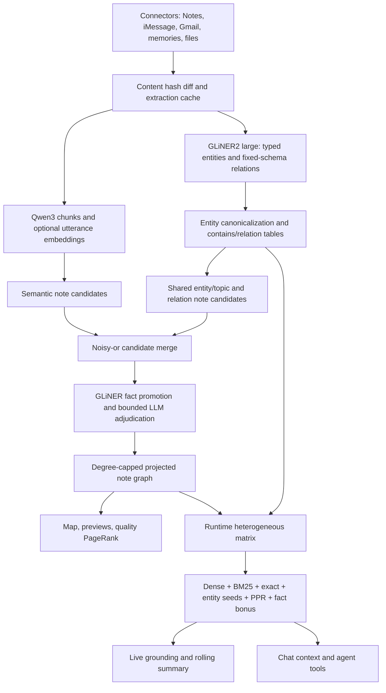
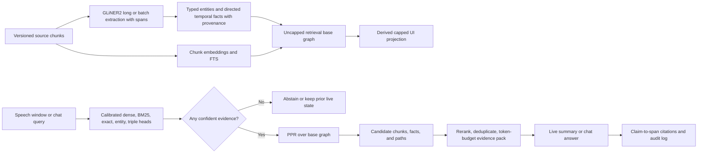

# Taurine knowledge-graph generation and retrieval review

**Date:** 2026-07-09

**Scope:** graph generation, entity/relation extraction, the projected note graph, heterogeneous PPR retrieval, live transcription retrieval and summarization, chat retrieval and tool use, and the current local database.

**System posture reviewed:** a small-to-medium, local-first personal knowledge base rather than a web-scale or enterprise knowledge graph.

## Executive conclusion

Taurine has a strong and unusually pragmatic foundation. It is local-first, incrementally indexed, uses a capable instruction-aware embedding model, combines dense/BM25/exact retrieval, has a real heterogeneous note/entity graph, and keeps the live retrieval loop free of online LLM calls. GLiNER2 is being used through its intended schema API, confidence scores are retained, and its DeBERTa-v3-large encoder is loaded through GLiNER2 correctly. The choice to use a constrained relation vocabulary is a defensible speed/privacy tradeoff for a personal graph.

It is not, however, a faithful HippoRAG 2 implementation. It is better described as a **HippoRAG-inspired hybrid note graph**. The main departures are consequential:

1. HippoRAG 2 builds a schema-free phrase/triple/passage graph; Taurine extracts a fixed entity/relation schema and projects much of that structure into capped note-to-note edges.
2. HippoRAG 2 links a query to triples, filters those triples, seeds phrase and passage nodes, runs PPR, and returns the original passages. Taurine retrieves note and edge-fact embeddings independently, applies uncalibrated additive fact bonuses, and ultimately gives the answerer mostly first-line note cards rather than the passages that earned retrieval.
3. Taurine's runtime heterogeneous graph includes projected shared-entity edges _and_ the underlying entity paths, so some evidence is counted twice. It also inherits the UI projection's degree cap.
4. Neither live nor chat retrieval has a meaningful null/abstention policy. On the current database, both meaningless filler and unrelated gibberish return the maximum 16 notes and 24 facts in chat retrieval.
5. There is no labeled evaluation set establishing whether the graph improves retrieval over dense/BM25, whether the GLiNER relation thresholds are optimal, or whether the final cited claims are supported by the cited source text.

The highest-return work is therefore not a larger model, a GNN, or community summaries. It is to make **evidence passages first-class**, calibrate retrieval and abstention, correct the graph double-counting and incremental rebuild drift, use GLiNER2's long-document API, and add provenance/temporal validity to facts. Those changes preserve Taurine's speed advantage and fit its personal-KB scale.

## Review method and evidence boundary

I traced the repository's relevant runtime, storage, connector, extraction, graph, retrieval, summarization, chat, server, UI integration, tests, approved specifications, and migration/ablation scripts. I also ran read-only diagnostics against a copy of the current database, compared incremental and full projection rebuilds, replayed null queries through the actual chat retriever, and benchmarked the locally bundled GLiNER2 model. I did not modify production data or the application implementation.

The research comparison uses primary sources and official implementations current through 2026-07-09:

- [HippoRAG 2 paper](https://arxiv.org/html/2502.14802) and [official implementation](https://github.com/OSU-NLP-Group/HippoRAG)
- [GLiNER2 official implementation and API](https://github.com/fastino-ai/GLiNER2) and [paper](https://arxiv.org/abs/2507.18546)
- [Qwen3 Embedding model card](https://huggingface.co/Qwen/Qwen3-Embedding-0.6B)
- [Microsoft GraphRAG dataflow](https://microsoft.github.io/graphrag/index/default_dataflow/) and [DRIFT search](https://microsoft.github.io/graphrag/query/drift_search/)
- [KG2RAG](https://aclanthology.org/2025.naacl-long.449/), [MS-RAG](https://aclanthology.org/2025.emnlp-main.1151/), [GeAR](https://aclanthology.org/2025.findings-acl.624/), and [GNN-RAG](https://aclanthology.org/2025.findings-acl.856/)
- [LeanRAG](https://ojs.aaai.org/index.php/AAAI/article/view/40789), [GFM-RAG](https://arxiv.org/abs/2502.01113), and [Zep/Graphiti temporal KG architecture](https://arxiv.org/abs/2501.13956)

## Current system beneath the hood

### End-to-end structure

The persistent graph has two overlapping representations:

- **Entity layer:** `entities`, `note_entities`, and `entity_relations` represent canonical entity nodes, note-to-entity `contains` edges, and provenance-scoped relation triples.
- **Projected note layer:** `edges` represents undirected note-to-note connections of type `semantic`, `topic`, `entity`, or `mixed`, optionally carrying a promoted GLiNER or LLM-written fact.

At query time, `HeteroGraphMatrix` reconstructs an in-memory graph containing all notes, all entity rows, every projected note edge, note/entity edges, and entity/entity relation edges (`core/taurine_core/indexer/rank.py:141-223`). PPR is run over that matrix, and its entity mass is discarded after the note rows are renormalized (`rank.py:225-279`).

### Current database snapshot

The following is the actual `core/taurine.db` snapshot modified at **2026-07-09 14:41:01 EDT**:

| item                               |         count |
| ---------------------------------- | ------------: |
| notes                              |           464 |
| chunk/utterance embeddings         |         1,084 |
| canonical entity rows              |         6,371 |
| note-to-entity rows                |         6,723 |
| entity relation triples            |           504 |
| projected note edges               |         1,417 |
| projected edges with facts         |           530 |
| fact embeddings                    |           538 |
| isolated notes                     |            55 |
| orphan entity rows (`df=0`)        | 1,413 (22.2%) |
| average / maximum projected degree |     6.11 / 12 |

Sources are 284 Apple Notes, 99 iMessage threads, 69 Claude memories, and 12 Gmail threads. Projected edges break down as follows:

| projected type | edges | mean weight | edges with facts |
| -------------- | ----: | ----------: | ---------------: |
| entity         |   485 |       0.517 |              194 |
| semantic       |   449 |       0.674 |              120 |
| mixed          |   407 |       0.860 |              201 |
| topic          |    76 |       0.486 |               15 |

This is small enough that exact sparse-matrix PPR and even full graph rebuilds are cheap. It is large enough that noisy hubs, stale facts, and uncalibrated retrieval materially affect results.

## How graph generation currently works

### 1. Incremental ingest and extraction

`sync_source` compares connector records to stored content hashes and a successful extraction cache (`core/taurine_core/indexer/sync.py:49-110`). Only changed or extraction-failed notes enter GLiNER2. Successful results are cached by note ID and content hash.

The extraction adapter builds one combined GLiNER2 schema containing eight entity types and twelve relation types (`core/taurine_core/indexer/extract.py:35-77`, `config.py:318-355`). Short notes are batched with confidence enabled and a global inference threshold of 0.45; entity and relation-specific thresholds are then applied client-side (`extract.py:80-117`, `extract.py:143-222`). Relations are retained only when both endpoints exactly match a retained entity after case-normalization.

Long notes take a different path: Taurine manually splits on whitespace into overlapping 384-word windows and calls generic `model.extract` on each (`extract.py:120-137` and its chunk helpers). Results are deduplicated by normalized surface text, but original/global offsets are not retained.

### 2. Embeddings and note representation

Notes are split approximately on sentence boundaries into at most 300 whitespace-token chunks. Documents are embedded without an instruction; queries use a task-specific `Instruct: ...\nQuery:` prefix (`core/taurine_core/indexer/embed.py:15-44`, `config.py:16-26`). That asymmetry matches Qwen3 Embedding's intended instruction-aware retrieval usage. Vectors are normalized to unit length.

The graph-level vector for a note is the normalized mean of its chunk embeddings (`core/taurine_core/indexer/graph.py:497-501`). A value-gated subset of changed notes also receives LLM-generated spoken aliases and utterances, but those do not replace the raw note representation.

### 3. Entity canonicalization

For each entity type, unique surfaces are embedded with Qwen3 and unioned when cosine similarity is at least 0.95, digit sequences match, and the strings are lexically compatible (`graph.py:608-670`). The lexical guard is important: the project's measured examples show that embedding similarity alone merges distinct places. The canonical form is the most frequent, then shortest, then lexicographically earliest form.

Canonicalization rewrites note extraction rows and rebuilds the `entity_surfaces` lookup. Concepts are lowercased; named types retain case (`graph.py:137-235`).

### 4. Candidate note graph

The projected graph combines three mechanisms:

- **Semantic:** all note-vector pairs are scored. Pairs above 0.55 are retained when either endpoint includes the other in its top six (`graph.py:238-270`).
- **Shared topic/entity:** every note pair is checked for canonical shared concepts or named entities. A rarity curve `1 / (1 + log(1 + df))` contributes weight; dates and entities appearing in more than 6% of active notes are excluded from the projection (`graph.py:273-310`, `graph.py:537-570`).
- **Extracted relations:** a note-scoped entity triple can connect the relation's source note to notes containing the opposite endpoint, with a small confidence-weighted contribution (`graph.py:313-366`).

Multiple mechanisms merge with a noisy-or formula. High-confidence GLiNER relations can write human-readable facts directly; otherwise cached LLM judgments can veto weak connections, admit near-misses, or add a fact (`graph.py:404-494`). A global greedy cap then limits every note to degree 12.

### 5. Projection and runtime graph

`index.graph()` exposes only notes and the capped note edges. This is appropriate for the map and note previews, and quality PageRank intentionally operates on this compact view.

The retrieval graph is then rebuilt by adding the entire projection to every note/entity and entity/entity relation edge (`rank.py:156-223`). This is not a clean separation between projection and source graph: the projection already contains entity/topic/relation-derived connections, and the corresponding entity paths are added again.

## Assessment of graph generation and GLiNER2/DeBERTa

### What is done well

1. **The local extraction architecture fits the product.** One cached GLiNER2 model, batch extraction, no per-note online LLM, and bounded corner adjudication are sensible for a private personal KB. A schema-free 70B OpenIE pass like the HippoRAG 2 experiment would be much slower and more expensive.
2. **GLiNER2 is being called correctly for ordinary inputs.** Entity descriptions, combined schemas, batch inference, and retained confidence values match the official API. The current `fastino/gliner2-large-v1` is a 340M model whose config names `microsoft/deberta-v3-large`; Taurine should treat DeBERTa as GLiNER2's encoder, not as a separate extraction model.
3. **There is no missing “direct DeBERTa” optimization.** Standard Hugging Face loading is the supported fallback. GLiNER2's optional FlashDeBERTa path is a GPU/CUDA acceleration; it is not the obvious choice for the current Apple/MPS local runtime.
4. **Measured performance is acceptable.** On this machine the bundled large model took 7.76 seconds cold and a median 134 ms per warm live extraction over 12 representative utterances (worst observed 166 ms). At an eight-second retrieval cadence, the warm extraction cost is not the bottleneck.
5. **Canonicalization is precision-conscious.** The digit and lexical guards avoid the common graph-destroying failure mode of merging semantically related but distinct named entities.
6. **Qwen3 usage is correct.** Bare document embeddings plus explicit query instructions follow the model's documented usage. The 1,024-dimensional setting is the model's full output dimension.

### Generation gaps

#### G1 — High: long documents bypass GLiNER2's long-document API

The approved design explicitly called for GLiNER2 long extraction with span remapping (`docs/superpowers/specs/2026-07-09-enrichment-streamlining-design.md:44-50`), but the implementation manually chunks whitespace words and calls `extract` (`extract.py:120-137`). GLiNER2's official `extract_entities_long`, `batch_extract_entities_long`, and generic `batch_extract_long` APIs scan overlapping chunks, remap global spans, and merge overlap detections.

The current approach has three problems:

- “384 words” is not “384 model tokens”; subword expansion can cause silent truncation at `max_len=384`.
- Sentence and relation boundaries can be broken in arbitrary places.
- No offsets/provenance survive, making it impossible to point a fact back to its evidence span.

**Recommendation:** use generic `batch_extract_long(texts, schema, chunk_size=384, chunk_overlap=64, include_confidence=True, include_spans=True)`. Preserve global spans for every entity and relation endpoint. Increase overlap only if a labeled calibration set shows boundary misses.

#### G2 — High: there is no extraction-quality evaluation, only an eyeballed calibration

The recorded 55-note review was useful, but it did not measure recall, per-type precision, relation endpoint coverage, or source-specific error. Current thresholds remain labeled “calibration-pending” (`config.py:322-323`). The corpus contains very different language in Notes, email, messages, and agent memories.

**Recommendation:** label 150-250 stratified notes, including long notes and noisy messages. Measure entity precision/recall/F1 by type, relation precision/recall by type, boundary accuracy, canonicalization pair precision, and extraction latency. Tune thresholds per entity/relation type or source only where the data supports it. Fine-tune/LoRA GLiNER2 only after errors show that prompting and thresholds cannot solve the dominant misses.

#### G3 — Medium: fixed relations are efficient but leave a real recall ceiling

The twelve-relation vocabulary is a deliberate departure from HippoRAG 2's schema-free OpenIE. It will miss decisions, preferences, causes, blockers, status changes, ownership transfers, and many personal-memory facts. Only 504 triples across 464 notes is sparse for a relationship-oriented graph.

**Recommendation:** keep fixed-schema GLiNER2 as the default, but make schemas source-aware and add high-value personal relation types after evaluation—for example `decided`, `prefers`, `blocked_by`, `responsible_for`, `completed`, and `supersedes`. For rare or high-value notes, a bounded open-relation extraction pass can remain a corner operation rather than the default pipeline.

#### G4 — High: projected and heterogeneous connectivity are double-counted

The design's heterogeneous layer called for note/entity `contains`, entity/entity relations, semantic note edges, and fact note edges. Instead, the runtime matrix adds every projected `entity`, `topic`, and `mixed` edge and then adds the underlying entity paths again (`rank.py:188-219`). Extracted relations likewise influence both projected note edges and entity/entity traversal.

This overweights shared entities and makes retrieval difficult to interpret. It also means the UI's degree-12 projection cap silently caps semantic/fact connectivity used by retrieval.

**Recommendation:** maintain two explicit edge views:

- **Retrieval base graph:** uncapped semantic note edges, adjudicated fact edges, note/entity contains edges, and directed entity relations. Do not add projected shared edges.
- **UI/quality projection:** the current degree-capped note view, derived from the base graph.

Add an ablation that compares dense-only, base graph PPR, and the current double-counted graph.

#### G5 — High: incremental projection rebuilds are order-dependent and drift

`sync_source` calls `rebuild_for` once for each changed note (`sync.py:131-145`). `rebuild_for` preserves all non-incident existing edges and admits incident edges only into the degree slots left by that current graph (`graph.py:79-108`). Deleted notes free degree slots, but unaffected notes are never reconsidered. The result depends on update order.

On a copy of the current database, a full `rebuild_all` changed the projection from 1,417 to 1,408 edges: 7 edges were added, 16 removed, and 12 retained pairs changed. That is direct evidence of projection drift.

**Recommendation:** at the present 464-note scale, perform one deterministic full graph rebuild after the complete connector batch. If scale later requires incremental maintenance, recompute the affected two-hop neighborhood and refill degree slots deterministically, then periodically run a full reconciliation.

#### G6 — Medium: entity resolution is too case-sensitive for speech and chat

The surface lookup intentionally preserves case for named types (`store.py:796-820`). Live ASR and typed queries commonly produce lowercase names; the live proper-name filter also rejects a single lowercase proper-name span (`live/spans.py:117-135`). Exact case improves precision but loses recall precisely in the speech path.

**Recommendation:** add a casefolded alias index with ambiguity tracking. Resolve case-insensitively when one entity dominates; require type/context disambiguation when multiple entities share the fold. Preserve the original display form.

#### G7 — Medium: graph housekeeping and failure semantics leak stale structure

The current entity table contains 1,413 `df=0` rows, and all of them become runtime matrix nodes (`rank.py:159-166`). There are also 538 fact embeddings for 530 current fact edges. A normal successful `refresh_fact_embeddings` prunes those rows, so the mismatch shows that stored derived state can lag the graph.

When extraction fails for a changed note, the new text and embeddings are written but old entity/relation rows are deliberately retained because extraction replacement is skipped (`store.py:294-318`). This maintains availability but makes the graph represent the old version of a changed note.

**Recommendation:** prune zero-reference entities and stale caches during full finalize; version extraction rows by content hash; and either exclude stale extraction from traversal or expose its status explicitly until retry succeeds.

#### G8 — Medium: directed facts become undirected traversal

Relations such as `works_at`, `scheduled_for`, `paid_or_owes`, and `part_of` are directional, but `HeteroGraphMatrix` adds entity relations with the same weight in both directions (`rank.py:181-219`). The projection is undirected as well.

**Recommendation:** preserve direction and provenance in the base graph. It is reasonable to allow a weaker reverse traversal for recall, but the evidence path and generated fact must retain subject, predicate, object, source note, confidence, and span.

#### G9 — Low now, high later: construction is quadratic

Semantic note candidates compare every note pair, shared edges compare every note pair, and canonicalization creates a full term-similarity matrix. At 464 notes and roughly 5,000 active surfaces this is acceptable. At several thousand notes or tens of thousands of surfaces it will dominate rebuild time and memory.

**Recommendation:** do not add infrastructure prematurely. Trigger an ANN/inverted-index rewrite when measured full rebuild time becomes operationally painful—roughly beyond 5,000-10,000 notes. Use matrix top-k/ANN for semantics and entity posting lists for shared candidates.

## Retrieval review: live transcription

### Current pipeline

Every eight seconds, the last three final transcript chunks form a query window (`live/ambient.py:125-174`, `live/ingest.py:444-450`). `C2_WINDOW_MIN_S=12` exists but is not referenced, so the window is chunk-count-based, not duration-gated.

The live heads are:

1. dense search over the whole window;
2. additional dense searches from up to four GLiNER2 spans, fuzzy-snapped forms, and sentence context;
3. BM25 over the window plus snapped terms;
4. exact aliases, each injected as its own rank-one RRF list.

RRF discards raw score magnitude and produces up to 20 fused notes (`live/ambient.py:44-94`). A decaying session accumulator adds the top ten fused notes; exact hits are added again at list-max strength (`live/grounding.py:322-347`). Query GLiNER spans transiently seed canonical entity nodes.

PPR runs over the heterogeneous graph. Separately, the query dense-searches fact embeddings. Each positive fact cosine contributes `score/2` to _both_ endpoint notes, and these bonuses are added directly to the normalized RRF/PPR blend (`grounding.py:193-258`). Recency, source, and quality priors then multiply relevance; hysteresis protects a top-12 set.

### What is done well

- Dense, lexical, exact, entity, graph, temporal, and source-quality signals are all present.
- The decayed accumulator and hysteresis are appropriate product adaptations for continuously changing speech.
- The entire retrieval path is local and its expensive GLiNER work is comfortably below the cadence.
- Stable `N#`/`F#` registries make rolling references possible.
- Conservative actionable extraction requires a transcript quote, confidence, and grounding.

### Live retrieval gaps

#### R1 — Critical: no abstention or calibrated relevance floor

The system always takes the top of each head even when every candidate is poor. RRF then treats an irrelevant rank-one result much like a relevant rank-one result because score magnitude is lost. Fact search likewise accepts every positive cosine.

Actual current-system results:

| query                                                   | notes returned | facts returned | top final score |
| ------------------------------------------------------- | -------------: | -------------: | --------------: |
| `the the um okay yeah right`                            |             16 |             24 |           1.042 |
| `completely unrelated zephyr quasar nonsense token`     |             16 |             24 |           0.850 |
| `What do my notes say about the recommendation engine?` |             16 |             24 |           0.895 |

The first two should normally abstain. Instead, filler can score above a plausible real query because additive facts and min-max normalization saturate the blend.

**Recommendation:** calibrate each head on positive and null windows. Reject dense/fact results below a learned or validation-set threshold, require BM25 evidence above a floor, and use weighted score-aware fusion or a small calibrated reranker. If no head clears confidence, return an empty/low-confidence grounding update and do not trigger a summary.

#### R2 — Critical: fact retrieval is not HippoRAG 2 query-to-triple seeding

HippoRAG 2 embeds the query against triples, filters the top triples with recognition memory, converts their phrases into PPR seeds, gives passage nodes similarity-weighted reset mass, and ranks passages from PPR. Taurine's fact hits are relationship sentences attached to projected note edges. They do not seed phrase/entity nodes; their raw cosines are summed as an unnormalized endpoint bonus (`grounding.py:204-218`, `grounding.py:248-258`). Multiple mediocre fact matches can dominate a note.

**Recommendation:** choose one coherent approach:

- Embed actual extracted triples and use accepted subject/object entities as PPR seeds; add dense note/chunk similarity to passage reset mass; or
- Treat fact search as another calibrated ranked head and fuse it through RRF/reranking rather than raw addition.

The first is closer to HippoRAG 2. An online LLM recognition filter is probably too slow for live speech; a confidence threshold or small local cross-encoder can provide the filter. Chat can afford a stronger recognition step.

#### R3 — Critical: the summarizer receives source cards, not answer-bearing passages

Each grounding note contributes only title, source, age, score, the first non-empty line, and up to three entity names (`live/summarizer.py:194-207`). It does not receive the matching chunk, sentence, or source span. Both HippoRAG 2 and GraphRAG local search return original passages/text units to the answerer; KG2RAG further organizes expanded chunks into coherent evidence.

The current `N#` validator proves only that an identifier exists, not that its source supports the claim. A summary with zero citations is accepted because `total <= 0` returns false from the rejection check (`summarizer.py:244-275`).

**Recommendation:** build a bounded evidence pack containing the best query/window-relevant one or two chunks per selected note, stable evidence/span IDs, fact paths, source timestamps, and provenance. Select with a reranker/MMR to avoid redundant notes. Require sentence-level citations for non-transcript factual claims and check that cited evidence contains or entails the claim.

#### R4 — High: transcript delta can discard unsummarized speech

The rolling delta is left-truncated at 6,000 characters while an LLM call may be in flight (`live/ingest.py:433-442`). On success, Taurine consumes the submitted prefix if it still matches; otherwise it clears the entire buffer (`ingest.py:361-371`). If new speech caused the buffer to roll, the prefix no longer matches and unsummarized new speech is lost.

**Recommendation:** store transcript chunks with monotonically increasing sequence IDs. A summary request records an inclusive checkpoint; acceptance advances the consumed checkpoint, regardless of later buffer trimming. Do not use mutable string-prefix identity for delivery semantics.

#### R5 — High: PPR has no dangling-node redistribution

Both PPR implementations column-normalize nonzero nodes, but zero-strength columns remain zero (`rank.py:76-86`, `rank.py:221-223`). Power iteration does not redistribute dangling mass to the teleport distribution (`rank.py:262-267`). This leaks probability and contradicts the quality-rank comment that isolated notes receive pure teleport mass.

**Recommendation:** on each iteration, compute mass on dangling columns and add `damping * dangling_mass * teleport`. Add invariant tests that total rank remains one and isolated seeded notes behave as documented.

#### R6 — Medium: entity hubs are filtered from projection but retained in traversal

Dates and high-document-frequency names are excluded from shared projected edges, but their `contains` edges stay in the heterogeneous graph by design. The current graph includes hubs such as the owner name and first-person references plus 846 date contains-edges. Column normalization also means a rarity scalar can partly cancel when an entity distributes only among notes.

**Recommendation:** maintain separate provenance and traversal flags. Keep all contains edges for inspection, but exclude date entities, ambiguous pronouns, zero-reference entities, and extremely high-df entities from PPR traversal unless the query explicitly seeds that entity.

#### R7 — Medium: exact evidence is counted twice and session memory can contaminate topic changes

Each exact match already participates as a rank-one RRF list, then `_advance_seeds` adds it again at maximum fused strength (`grounding.py:336-341`). The accumulator is useful, but a fixed 0.85 decay can keep an old topic active after a hard conversational pivot.

**Recommendation:** remove the duplicate exact addition or explicitly calibrate one exact boost. Reset or sharply decay the accumulator when embedding drift/topic-boundary evidence is strong. Evaluate both on labeled session replays.

## Retrieval review: chat

### Current pipeline

Chat reuses the same dense, BM25, exact, GLiNER entity-seed, PPR, fact, and prior machinery with a broader top-16/24 pack, no hysteresis, and a 0.7 turn-to-turn accumulator decay (`chat/retrieval.py:33-107`). Despite the older design spec saying otherwise, the implemented chat path _does_ run GLiNER2 spans, which is reasonable.

The initial model context contains note cards and fact sentences, not note chunks (`chat/engine.py:586-667`). The model can then use six total calls across:

- `search_notes`: another full retrieval pass, returning cards;
- `read_note`: the first 6,000 characters plus all neighbors;
- `expand_note`: up to 12 projected neighbors.

Unknown citation IDs are stripped, and all initial retrieved notes/facts are attached to the final message's source rail even when the answer did not cite them (`chat/engine.py:728-774`).

### What is done well

- Sharing the live retrieval substrate avoids a second, inconsistent search stack.
- Chat's broader recall, faster accumulator decay, and lack of hysteresis are appropriate.
- Agentic search/expand/read is consistent with GeAR and GraphRAG DRIFT's finding that multi-step exploration helps multi-hop questions.
- Persistent citation registries allow references across turns and restarts.

### Chat gaps

#### C1 — Critical: the initial context cannot answer from the retrieved evidence

Sixteen cards tell the model which notes might matter but not what those notes say. The model must spend a six-call budget reading sources one by one. A multi-note synthesis can exhaust the budget before gathering evidence.

**Recommendation:** make Stage A an evidence pack, not a catalog. Include the best relevant chunk from each of the top few notes and compact metadata for the remainder. Chat can rerank 30-50 candidate chunks/relations/entities with a local cross-encoder or a single bounded LLM selection step. MS-RAG's chunk/relation/entity indexes plus multi-semantic reranking are a close fit.

#### C2 — Critical: tool results are not consistently registered or citeable

`search_notes` returns `short_id` and is captured as a source. `read_note` and `expand_note` return raw note IDs for neighbors, do not register newly discovered notes, and `_capture_tool_sources` only reads a `rows` array (`chat/tools.py:76-161`, `chat/engine.py:698-725`). A note discovered through expansion may influence the answer without a valid `N#` citation.

**Recommendation:** every tool result must pass through one registry function that assigns/returns stable note, fact, path, and evidence IDs. Capture source provenance from _all_ tools, not only search.

#### C3 — High: `read_note` is neither full nor query-aware

The tool describes itself as reading a full note but silently truncates to the first 6,000 characters (`chat/tools.py:40-45`, `chat/tools.py:121-130`). Relevant content later in a long note is invisible, while an unbounded neighbor list can consume tokens.

**Recommendation:** replace it with `read_note(note, query, cursor, max_chars)` returning the best query-relevant spans plus optional pagination. Cap and rank neighbors. Include stable span IDs and character offsets.

#### C4 — High: citations are syntactically valid but not semantically validated

The chat finalizer checks only whether `N#`/`F#` belongs to the registry. It also returns every initial retrieved item as a “source,” cited or not (`engine.py:754-773`). This overstates support.

**Recommendation:** distinguish **retrieved**, **read**, and **cited** sources in storage/UI. Attach only cited sources to the answer's primary source list. Add claim-to-evidence validation for factual sentences; at minimum require the citation to point to a supplied/read passage, not merely a metadata card.

#### C5 — Medium: multi-turn accumulator needs query rewriting/topic control

The last 12 turns are supplied verbatim, while retrieval embeds only the current message and carries old note seeds at 0.7 decay. Pronouns can under-retrieve; abrupt topic changes can over-retrieve old context. Regeneration also advances retrieval state again instead of replaying from a snapshot.

**Recommendation:** create a small conversation-aware retrieval query that resolves references, condition accumulator retention on topic similarity, and snapshot/restore retriever state for regeneration.

#### C6 — Medium: graph expansions are not organized into explanatory paths

PPR returns high-mass notes but not the path that caused them to surface. `expand_note` exposes a flat neighbor list. KG2RAG, LeanRAG, and GNN-RAG all emphasize organizing graph expansion or shortest paths so the generator gets compact, coherent evidence rather than disconnected nodes.

**Recommendation:** for multi-hop chat, return one or two short provenance-preserving paths connecting query entities, seed notes, and selected answer notes. At this scale, weighted shortest paths or a small Steiner approximation are sufficient; a trained GNN is unnecessary.

## HippoRAG 2 fidelity matrix

| HippoRAG 2 element                                 | Taurine status                                             | assessment                                                                    |
| -------------------------------------------------- | ---------------------------------------------------------- | ----------------------------------------------------------------------------- |
| Passage nodes connected to extracted phrases       | notes connected to typed entities                          | broadly aligned, but note-level nodes are coarser than answer passages        |
| Schema-free OpenIE triples                         | fixed GLiNER relation vocabulary                           | intentional speed/privacy tradeoff; lower relation recall                     |
| Synonym phrase connections                         | embedding + lexical canonical merge                        | precision-oriented and appropriate, but misses acronyms/nicknames             |
| Query-to-triple retrieval                          | dense search over edge-fact text                           | partial resemblance only; current hits do not seed triple phrases             |
| Recognition filter on top triples                  | none in live; no dedicated filter in chat                  | missing; replace with calibrated local filter live, stronger filter chat      |
| Similarity-weighted passage reset for all passages | top fused note accumulator only                            | partial, product-adapted; should test all-passage/chunk reset in chat         |
| Phrase/entity reset nodes                          | GLiNER spans seed canonical entities                       | aligned in spirit, but case-sensitive and sparse                              |
| PPR ranks passages                                 | PPR ranks notes then blends priors/fact bonus              | reasonable adaptation, but double-counted graph and raw fact bonus distort it |
| Original passages feed final QA                    | first-line cards; raw text only through limited chat reads | major missing component                                                       |
| Dense fallback when no triples                     | dense always participates                                  | aligned, but lacks a confidence/null gate                                     |

## Recommended target architecture

Key properties:

1. **Chunk/evidence identity is first-class.** Notes remain the user-facing document, but retrieval and citations resolve to the answer-bearing span.
2. **One uncapped base graph, one derived projection.** Retrieval never depends on a visualization cap and never repeats entity-derived edges.
3. **Facts are provenance-rich and temporal.** Store `subject`, `predicate`, `object`, `confidence`, `source_note`, `source_span`, `observed_at`, and optional `valid_from`, `valid_to`, `superseded_by`.
4. **Every retrieval head can say no.** Confidence gates precede fusion and generation.
5. **Graph traversal explains itself.** Selected evidence keeps the path and source spans that contributed to it.
6. **Live and chat share indexes, not necessarily identical policies.** Live should optimize latency and precision; chat can afford reranking, query rewriting, and limited agentic exploration.

## Prioritized implementation roadmap

### P0 — establish correctness before tuning

1. Build a labeled retrieval benchmark from real session windows and chat questions. Include single-note, multi-note, entity, temporal, and null queries with supporting note/span IDs.
2. Add score/abstention calibration and report empty grounding for null input.
3. Introduce query-relevant evidence chunks in both live summarizer and chat Stage A.
4. Fix the transcript-delta checkpoint race.
5. Make every chat tool result register stable citeable evidence IDs; separate cited from merely retrieved sources.
6. Add citation coverage and claim-to-evidence checks.

### P1 — correct graph semantics and extraction

1. Replace manual long-note extraction with GLiNER2 `batch_extract_long`, preserving spans.
2. Split the uncapped retrieval base graph from the degree-capped UI projection; remove projection/entity double-counting.
3. Full deterministic rebuild once per connector batch; prune orphan entities and derived-state drift.
4. Add dangling-node redistribution and probability-mass invariant tests.
5. Add casefolded, ambiguity-aware entity aliases and query entity resolution.
6. Store directed fact provenance and basic temporal validity/supersession.

### P2 — improve retrieval quality after the benchmark exists

1. Embed actual triples and seed entity endpoints, or fuse fact search as a calibrated head.
2. Rerank the top candidate chunks/facts/paths; use MMR or source caps to reduce redundancy.
3. Add topic-shift-aware live/chat accumulator resets and query rewriting for chat.
4. Add compact path evidence for multi-hop questions.
5. Expand or specialize GLiNER relation schemas only from measured error categories.

### P3 — optional features, only if user queries justify them

1. Add community/global summaries for corpus-wide questions such as “what themes recur across my notes?” GraphRAG/DRIFT or LeanRAG-style hierarchy is useful here, but unnecessary for ordinary entity/local retrieval at 464 notes.
2. Consider GFM-RAG or a trained GNN only if a sizable labeled multi-hop benchmark shows PPR/path retrieval has plateaued. The current graph is too small and sparse to justify that complexity.
3. Move quadratic construction to ANN/posting-list candidates when measured rebuild time, not theoretical scale, demands it.

## Evaluation plan and acceptance criteria

### Generation

- Entity precision/recall/F1 by type and source.
- Relation precision/recall by predicate; endpoint and direction accuracy.
- Long-document boundary recall and span-offset correctness.
- Canonicalization pair precision plus acronym/nickname recall.
- Orphan/stale-row counts after every full finalize should be zero unless explicitly version-retained.
- Ingest latency p50/p95 and full rebuild wall time.

### Retrieval

- Recall@5, Recall@12, nDCG@10, and MRR for support notes and support spans.
- Multi-hop support-set recall: all required evidence passages retrieved.
- Null false-grounding rate and empty-result precision.
- Graph lift over dense+BM25: report both gains and regressions, not only aggregate score.
- Ablations: dense, dense+BM25, +entity seeds, +PPR, +facts/triples, +priors, +reranker.
- Live latency p50/p95, grounding churn, false surfaces per hour, and time-to-first-relevant evidence.

### Generation/answer grounding

- Citation coverage: fraction of factual claims with citations.
- Citation correctness/entailment: fraction supported by the cited span.
- Source precision: retrieved versus read versus actually cited.
- Temporal correctness on contradictory/superseded facts.
- Chat answer correctness and completeness for single-hop, multi-hop, and global questions.

Do not set production thresholds from the current score distribution alone. First label a representative validation split, then lock thresholds and evaluate once on a held-out split.

## Research-informed choices to adopt or defer

| research direction                                  | use in Taurine                      | decision                                                          |
| --------------------------------------------------- | ----------------------------------- | ----------------------------------------------------------------- |
| HippoRAG 2 passage + phrase PPR and query-to-triple | directly relevant to current gaps   | adopt passage reset/evidence return; redesign fact/triple seeding |
| KG2RAG graph expansion + context organization       | compact coherent evidence           | adopt for chat evidence packs and paths                           |
| MS-RAG chunk/relation/entity indexes + reranking    | close match to existing indexes     | adopt a lightweight rerank after evaluation                       |
| GeAR/DRIFT agentic exploration                      | useful for ambiguous/multi-hop chat | keep in chat, not live speech                                     |
| Zep/Graphiti temporal validity and provenance       | personal facts evolve over time     | adopt minimal validity/supersession fields                        |
| LeanRAG/community hierarchy                         | global/corpus-theme queries         | defer until query logs show demand                                |
| GNN-RAG/GFM-RAG                                     | trained deep graph retrieval        | defer; insufficient scale/labels and higher complexity            |

## Final assessment

Taurine's core architectural instinct is right: use local extraction and hybrid retrieval for recall, use a graph for association, and reserve LLM calls for high-value ambiguity and final synthesis. The current implementation already has more of the necessary substrate than most prototypes.

The main risk is that the system looks grounded because it has a graph and citation IDs while the final model often lacks the source passage needed to ground the claim. The second risk is silent over-retrieval: every input is forced into a full evidence set, and multiple graph/fact signals can amplify one another without calibration. Correcting those two issues will produce a larger practical gain than adding a newer graph model.

For a small-to-medium personal KB, the recommended endpoint is deliberately modest: a clean heterogeneous base graph, a separate visual projection, versioned span-level evidence, calibrated hybrid entry points, PPR/path expansion, lightweight reranking, temporal provenance, and strict evidence-aware citations. That is both closer to the strongest parts of HippoRAG 2 and better matched to Taurine's real-time privacy and latency requirements than a heavyweight GraphRAG or learned-GNN stack.
