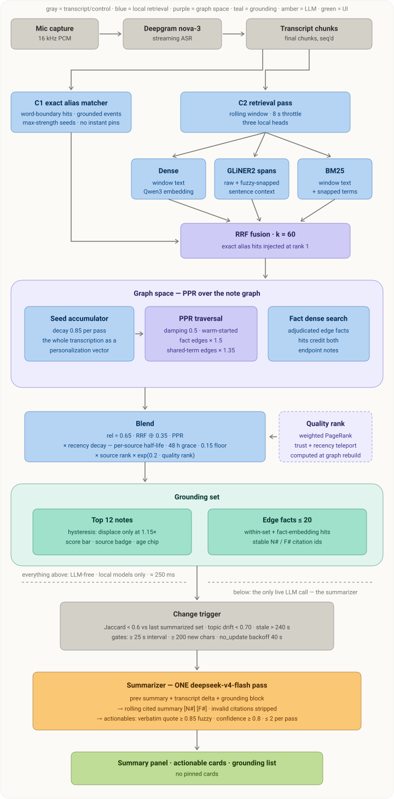
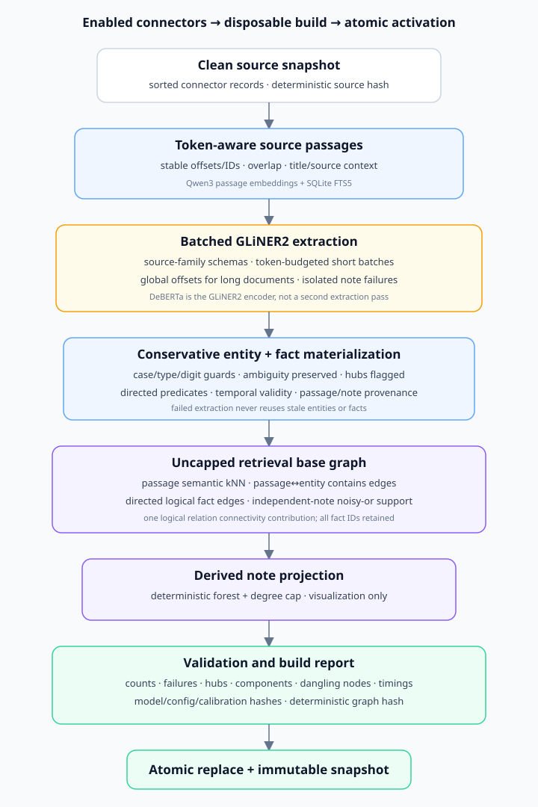

# Architecture diagrams

Self-contained SVGs (embedded stylesheet, no external assets) — open in a
browser or view inline on GitHub.

## [Live voice retrieval pipeline](live-voice-retrieval-pipeline.svg)

Mic audio streams through Deepgram into final transcript chunks. C1's
word-boundary alias matcher turns exact hits into max-strength seeds (the
old instant-pin cards are gone); every 8 s, C2 runs three local heads —
dense window embedding, GLiNER2 spans (raw + fuzzy-snapped + sentence
context), and BM25 — fused by RRF with exact hits injected at rank 1. Fused
lists feed a decaying seed accumulator (the whole transcription as a
personalization vector) that drives Personalized PageRank over the
fact-boosted note graph, joined by a dense search over adjudicated edge
facts. Relevance blends with PPR mass, then recency decay, source rank, and
quality rank shape a hysteresis-protected grounding set with stable N#/F#
citation ids — everything to this point is LLM-free and local (~250 ms). A
change trigger (grounding-set Jaccard, topic drift, staleness) fires the
single live LLM call: one deepseek-v4-flash pass that maintains a rolling
cited summary and conservative quoted-span actionables.

See also [`../superpowers/specs/2026-07-08-live-summary-graph-retrieval.md`](../superpowers/specs/2026-07-08-live-summary-graph-retrieval.md).

## [Enrichment & graph connection pipeline](enrichment-graph-connection-pipeline.svg)

Connector sources are extracted and hash-diffed so only changed notes are
re-enriched. Notes are clustered by embedding similarity and enriched in
one keyed GLM-5.2 call per batch (user card as shared context, per-note
validation with a per-note fallback), then embedded with Qwen3. The cheap,
LLM-free graph build resolves synonym terms to canonical forms (digit +
lexical guards), draws semantic kNN and rarity-weighted shared-term edges,
and merges them per pair by noisy-or. deepseek-v4-pro then adjudicates only
the band pairs the cheap signals flag — writing facts onto strong edges,
vetoing weak ones, admitting near-miss margins — caching every verdict by
note-content signature so future rebuilds apply it for free.

See also [`../superpowers/specs/2026-07-07-graph-connections-v2.md`](../superpowers/specs/2026-07-07-graph-connections-v2.md).
