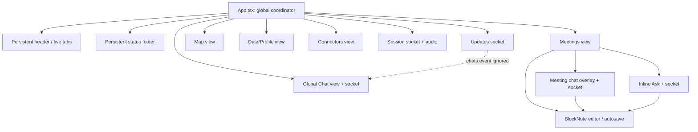
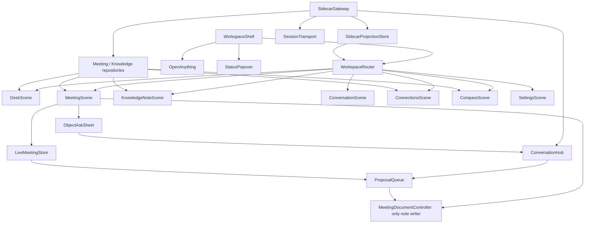
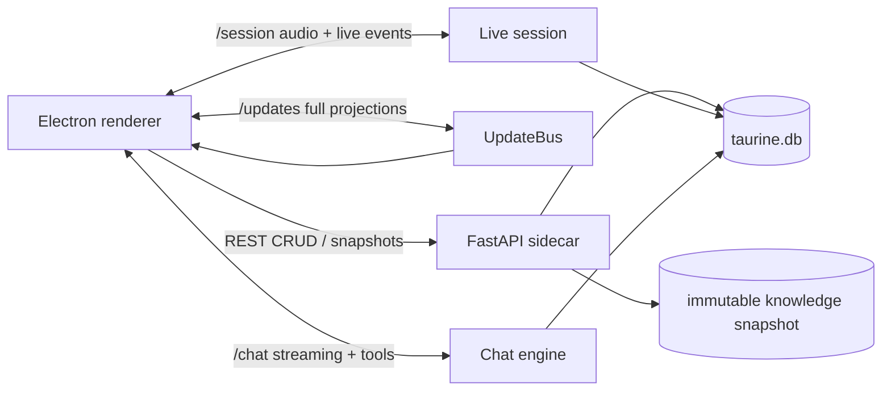

# Taurine Quiet Canvas — Desktop Product and Frontend Architecture

**Date:** 2026-07-20
**Status:** Implementation-grade redesign specification
**Track:** A — calm, low-cognitive-load, progressively disclosed, meeting-immediate
**Scope:** Electron shell, renderer information architecture, interaction design, accessibility, frontend state architecture, and the smallest justified sidecar contract additions
**Primary evidence:** current `app/` and `core/` implementation, repository history through 2026-07-20, meeting and graph design history, retrieval audits, and the round-4 ablation report

## Executive decision

Taurine becomes a **quiet object workspace**, not a dashboard and not a cockpit.

The application opens to a Desk: one calm surface for beginning or reopening work. A meeting is one durable document whose center is the user's freely editable note. Before the meeting it is a prepared page; during the meeting the same page becomes a live working note; afterward it becomes a reviewable record. The interface changes mode around that object without changing its identity or moving the user into another product area.

There is no persistent product sidebar, no row of five tabs, no global status footer, and no default global graph hairball. Navigation is provided by back/forward history, a compact title-bar breadcrumb, and an **Open anything** switcher. Secondary material—transcript, evidence, retrieval diagnostics, sync detail, AI activity—appears only when requested or when a user-actionable exception demands attention.

The two ideas worth preserving are substantially reimagined:

1. **Free-edit meeting notes** are the primary object and the single editing authority. AI never silently rewrites them; it proposes a bounded, inspectable change that the user can accept, reject, or undo.
2. **The knowledge graph** becomes Connections: an object-centered explanation of why a note is relevant and how it relates to nearby knowledge. A visual graph is one optional representation, paired with a fully operable semantic list. It is not the application's home or its navigation model.

The Python sidecar remains the system of record and retains its retrieval, graph, connector, meeting, chat, profile, and finalization machinery. Most work is a renderer and Electron-shell replacement. Three narrow contract repairs are required for a trustworthy UI: revision-safe meeting mutations, resumable live-session state within the existing disconnect grace window, and persisted post-meeting actionable review state. In-app OAuth can follow as a separate connector-hardening phase.

---

## 1. Product thesis and design invariants

### 1.1 Product thesis

Taurine should feel like opening a good notebook that happens to understand the user's knowledge—not like operating an AI system.

The interface exists to make five moments effortless:

1. start capturing without setup;
2. write without managing AI or transcript state;
3. notice one relevant fact when it materially helps;
4. ask a grounded question without leaving the object;
5. turn the meeting into a reliable record without surrendering authorship.

Everything else is supporting infrastructure and must earn its way onto the screen.

### 1.2 Non-negotiable invariants

1. **One object, one center.** Every primary scene has one named object: Desk, meeting, knowledge note, conversation, Connections exploration, or a settings page.
2. **The editor is not a panel.** In a meeting, the note occupies the primary reading axis and receives the first focusable content position.
3. **Information earns visibility.** Transcript, live summaries, retrieval traces, source status, and AI reasoning are hidden until relevant, requested, or failed.
4. **One writer owns meeting notes.** Only `MeetingDocumentController` mutates the BlockNote document. Chat, inline Ask, final summary, and live suggestions submit proposals to it.
5. **AI proposes; people commit.** No AI path writes accepted note content before explicit acceptance. Accepted changes are one editor transaction and are undoable.
6. **Truth beats reassurance.** “Saved,” “connected,” “protected,” “verified,” and “recording” appear only when the corresponding state is known. Best-effort privacy is labeled best-effort.
7. **A canvas always has a semantic equivalent.** The visual Connections canvas is never the only way to discover, inspect, or act on nodes and edges.
8. **No content in status chrome.** Persistent chrome may name location or expose a command. It may not stream transcript, evidence, sync counters, model activity, or connection telemetry.
9. **Failures stay local.** A connector failure does not interrupt note editing; a graph failure does not break a meeting; an AI failure does not alter the note; a websocket failure never masquerades as success.
10. **The sidecar remains authoritative.** Durable meetings, transcripts, suggestions, chats, profile, connector state, and graph generations remain in the sidecar. Renderer caches are replaceable projections.

### 1.3 Explicit non-goals

- a feed, daily briefing, project dashboard, people CRM, productivity score, or proactive recommendation stream;
- a persistent app-wide navigation sidebar;
- a command center full of live service indicators;
- using the graph as the app's file system;
- exposing chain-of-thought or raw model reasoning by default;
- visually mimicking the current dark charcoal/yellow, translucent-card, tiny-pill style;
- claiming that Electron content protection makes Taurine invisible to screen sharing;
- changing retrieval ranking, enrichment, graph construction, ASR provider, or LLM model policy as part of the UI rewrite.

---

## 2. Evidence-based current-system inventory

### 2.1 Existing capability inventory

| Capability | Current implementation truth | Redesign disposition |
|---|---|---|
| Desktop lifecycle | Electron main process owns a 1500×950 primary window, tray, hide-on-close behavior, dock behavior, native call watcher, system-audio tap, and popup windows | Preserve lifecycle; replace window sizing, privacy communication, and popup policy |
| Call detection | Native CoreAudio helper detects mic use; a non-focusable 344×108 prompt appears on all Spaces; current countdown can auto-start | Preserve detection and non-focus behavior; default to explicit one-click start; make optional auto-start a clearly enabled preference |
| Audio capture | Renderer sends channel 0 mic and channel 1 system audio as 16 kHz PCM on `/session`; macOS 14.2+ system capture is available | Preserve; expose honest channel health only in the meeting capture control |
| Meetings | Durable draft/live/summarizing/done records; free BlockNote notes; transcript persistence; final summary; suggested edits; meeting-linked chat | Make the meeting document the primary product object |
| Live intelligence | Grounded rolling summaries, actionables, displayed evidence, snippets, note suggestions, retrieval trace, abstention and low-confidence states | Show a small contextual margin; disclose provenance and confidence on demand; disable OS note popups by default |
| AI note editing | Final summary creates pending suggested edits; meeting chat emits renderer-applied `chat_notes_edit`; inline Ask currently streams directly into the note; provenance is tracked by normalized line text | Unify all paths as proposals; eliminate direct streaming writes; retain accepted AI provenance as a subtle annotation |
| Transcript | Final/interim chunks, You/Them channel labels, search, copy, persistent meeting transcript | Make it a drawer, not a co-equal live pane |
| Chat | Durable threads; streaming; stop/regenerate; tool activity; retrieved/consulted/cited evidence; meeting-scoped evidence and edit tool | Make Ask contextual to an object or a standalone conversation document; remove persistent chat sidebar |
| Retrieval evidence | Passages, facts, paths, notes, temporal data, low-confidence fallback, decision confidence, prior context, dates, traces | Parse the full existing schema; do not drop `fallback`, `low_confidence`, `passage_date`, `prior_context`, or stripped-claim metadata |
| Knowledge graph | Global and local graph endpoints; clusters; source/community/recency lenses; facts and mechanisms; idea search; note previews; graph-to-chat seeding | Recast as object-centered Connections with visual/list parity; retain global atlas only as an explicit advanced scope |
| Connectors | Apple Notes, Obsidian, local folders, iMessage, Claude/Codex memories, Gmail, Outlook, Google Calendar, Google Docs, plus hidden Taurine meetings; enable/disable/config/sync/delete | Move to Settings → Sources; summarize state, progressively disclose config/destructive actions |
| Sync/index | Startup progress, periodic and manual sync, cancel, stale/error state, atomic knowledge snapshot generation | Remove from global footer; expose in a status popover and Sources; preserve editing during sync |
| User profile | Durable manually editable profile; explicit research-agent generation with phases and progress; uncitable context for agents | Move to Settings → Personal context; show concise research progress only while open |
| Session logs | JSONL debug records and `/sessions` list/detail endpoints | Move to Settings → Diagnostics; never present as meeting history or normal user content |
| Tray | Show Taurine, Start meeting, Quit | Preserve; add current capture label and Stop meeting while live |
| Privacy control | `setContentProtection(true)` is applied to windows; app claims invisibility in comments/product behavior | Preserve platform request but replace claim with truthful capability state and presentation-safe mitigations |

### 2.2 High-impact inventory

The redesign prioritizes by consequences, not implementation size.

| Priority | Moment | Required outcome | Failure budget |
|---|---|---|---|
| P0 | Start capture | Meeting created/bound, mic started, supported system audio started, durable status visible | One click from call prompt/tray/Desk; acknowledgement within 700 ms; honest partial-channel state |
| P0 | Write notes | Keystrokes remain responsive and recoverable; autosave never overwrites a newer revision | No lost accepted keystrokes; editor interaction under 16 ms/frame on normal documents |
| P0 | Stop capture | Pending note mutation and live notepad context flush before stop/finalization | One unambiguous action; no stale final-summary input |
| P0 | Disconnect | Capture interruption is visible; reconnection preserves the current live summary/actionables within grace or explicitly reports a reset | Never display “Listening” while session socket/ASR is unknown |
| P0 | AI edit | User sees scope and provenance before content becomes canonical | Accept/reject/undo; no AI path bypasses the proposal queue |
| P0 | Privacy | User understands what can and cannot be hidden from capture | No “invisible” or guaranteed-protection copy on macOS ScreenCaptureKit |
| P1 | Relevant knowledge | One useful connection can be noticed without scanning a feed | Maximum three quiet context items before “More”; no popup by default |
| P1 | Grounded answer | Answer distinguishes cited, consulted, low-confidence, interrupted, and repaired/stripped states | No generic “verified” badge |
| P1 | Post-meeting review | Summary and actionables can be accepted, revised, or dismissed without losing original notes | Review survives reload |
| P1 | Source health | User can identify stale/unavailable sources and recover | Problems visible in status popover and Sources, not persistent chrome |
| P2 | Graph exploration | User can understand a connection and traverse it using pointer or keyboard | Semantic list feature parity with visual canvas |
| P2 | Profile/diagnostics | Advanced operations remain reachable without dominating ordinary work | Reachable through Open anything and Settings |

### 2.3 Current liabilities to remove

1. **Five persistent top-level tabs** force the user to classify intent before acting and keep unrelated product areas visually present.
2. **Persistent header and footer telemetry** makes localhost service health, ASR, index count, and sync state part of every task.
3. **A monolithic `App.tsx` coordinator** owns route, meeting, audio, status, graph handoff, popups, and multiple socket lifecycles; hidden tab trees remain mounted.
4. **Multiple chat/socket owners** exist for global chat, meeting chat, inline Ask, session, and updates. Reconciliation rules differ, and the updates client ignores the server's `chats` push.
5. **Multiple note writers** compete: editor autosave, final suggestions, chat edits, and direct inline AI insertion. `notes_rev` exists, but normal PATCH does not enforce an expected revision.
6. **AI interaction semantics conflict.** Some content is a pending suggestion, some is applied as gray text, some streams directly into the note, and chat can report a note edit as applied before the renderer actually commits it.
7. **Reconnect is only transport-level.** The client replays `start`, but the server constructs a fresh `LiveSession`; rolling summary, actionables, grounding state, and snippet-session memory can reset while the meeting remains live.
8. **The visual map is not accessibly equivalent.** A force-directed canvas contains essential targets and relationships without a canonical keyboard/screen-reader representation.
9. **The renderer drops meaningful evidence fields** including fallback, low confidence, passage dates, prior-context status, richer tool activity, interrupted state, and stripped claims.
10. **The current visual system is dense despite dark surfaces.** Tiny labels, translucent cards, repeated pills, glow/heat treatments, and yellow status accents create continuous visual competition.
11. **OAuth setup is desktop-hostile.** The UI may tell a user to run a terminal command and restart.
12. **Privacy wording overstates platform capability.** Electron documents that newer macOS ScreenCaptureKit applications can capture a window even with `setContentProtection(true)`.
13. **Retrieval confidence is architecturally mature but empirically unfinished.** The 2026-07-10 review records zero-sample calibration artifacts, while the round-4 ablation shows routed and dense answers each omit or overreach on different questions. UI language must expose evidence quality without presenting retrieval as certainty.

### 2.4 Durable and ephemeral state inventory

| State | Current owner | Durable? | New renderer owner |
|---|---|---:|---|
| Meeting metadata, notes, revisions, transcript, summary, suggestions, AI line provenance, chat binding | SQLite via sidecar | Yes | `MeetingRepository` cache + `MeetingDocumentController` |
| Live summary, actionables, grounding accumulator, snippets | Live sidecar session | No | `LiveMeetingStore` projection; resumable within grace after contract repair |
| Audio devices/capture streams | Renderer/Electron | No | `CaptureController` |
| Startup, connector, sync, graph version, profile generation, meeting list, chat list | Sidecar runtime + `/updates` | Mixed | One `SidecarProjectionStore` |
| Chat messages and retrieval audit | SQLite via sidecar | Yes | `ConversationStore` keyed by chat ID |
| In-flight streamed chat deltas/activity | Chat websocket | No until terminal persistence | `ConversationStreamStore` |
| Graph/note snapshot | Immutable knowledge runtime | Derived, replaceable | `KnowledgeRepository` cache keyed by graph version |
| Navigation history, open drawers, selected graph node, command query | Renderer | No | `WorkspaceRouter` + scene-local state |
| Comparison set (2–3 object references) | New renderer working context | No | `comparisonSet`; clears on restart |
| Privacy-curtain state | Electron main + renderer shell | Preference for current app lifetime only | Main broadcasts before peripheral first paint; `WorkspaceShell` suppresses scene rendering |
| Dirty meeting recovery copy | New Electron main recovery journal | Local encrypted, expendable | `DraftJournal` + narrow preload + `safeStorage`; memory-only if unavailable |
| Graph pins/filter preferences | Browser localStorage today | Local durable preference | `PreferenceStore`, versioned |
| Window bounds and compact mode | Electron | Local durable preference | Main-process `WindowStateStore` |
| Session logs | JSONL | Yes, diagnostic | Diagnostics repository only |

### 2.5 Trust language and capability completeness

The following words are product contracts, not stylistic variants:

- **Cited:** the accepted output contains this evidence identifier, and that identifier was available to the turn. It does not assert that the cited passage entails the sentence.
- **Consulted:** the answer model read this evidence, but the accepted output did not cite it.
- **Retrieved:** retrieval considered or selected this evidence; the answer model may not have read it.
- **Evidence policy passed:** the retrieval decision accepted the pack under the configured policy. Never render this as `Verified`, `Fact checked`, or `True`.
- **Low-confidence fallback:** below-floor passages were supplied for best-effort exploration; the sidecar withheld facts and paths. Every displayed fallback passage retains a `Tentative` label.
- **No supported evidence:** nothing cleared the retrieval floor. Omit an empty Sources block and state insufficiency where it affects the answer.
- **From earlier context:** the evidence was carried into the turn and was not retrieved for the current question.
- **Citation checks passed:** identifiers, availability, fact provenance, and temporal consistency passed the sidecar's checks. It is not an entailment claim.
- **Interrupted / stopped before verification:** the partial stream was persisted without final evidence validation and has no cited-support set, even when its raw text contains citation-shaped markers.
- **Calibration not validated:** an active calibration artifact with zero labeled/held-out samples cannot justify a user-facing confidence claim. Numeric confidence remains in Advanced diagnostics; ordinary UI uses decision categories.

An evidence item that occurs in multiple sets is shown once at its highest state: Cited, then Consulted, then Retrieved. Counts are computed from distinct evidence IDs, not payload-row count. Facts retain direction and `active`, `historical`, `superseded`, `conflicted`, or `candidate` status when supplied. Relative dates always have an absolute local-date disclosure. Unknown/missing evidence fields render as unavailable; the renderer never invents a default confidence or current-tense claim.

The table below is the loss-prevention checklist for replacing the existing interface. `Default` describes visibility, while the last column names the release proof required before the legacy surface is deleted.

| Capability, contract, or required replacement behavior | Quiet Canvas destination | Default and state/error coverage | Release proof |
|---|---|---|---|
| Main window, hide-on-close, dock, tray | Desktop lifecycle + native app/Meeting menus | Ambient; hidden/visible/quitting/live states | Native platform matrix |
| Call watcher, debounce, countdown, rearm | Call prompt + Privacy & Capture | Prompt only; unsupported/off/ask/optional-auto/start/error/rearm | Call-detection E2E |
| Relevant-note popup and queue | Meeting Context + optional peripheral prompt | In-document by default; queued/dismissed/timed/redacted | Window/privacy tests |
| Content-protection request | Privacy & Capture + privacy curtain | Requested/limited/unavailable/curtain; never guaranteed | Screen-share matrix |
| Mic/system-audio capture and devices | Capture control/popover | Full/partial/permission-denied/lost/reconnecting | Capture reducer + native test |
| `/session` transcript/status | Transcript drawer + capture control | Closed by default; interim/final/gap/channel error | Session fixture + meeting E2E |
| Rolling summary and grounding | Context margin + evidence disclosure | First accepted revision only; abstained/no-new/degraded/reset | Live reducer tests |
| Actionables | Context margin + Review changes | Proposed/confirmed/dismissed; user status wins | Meeting E2E + persistence test |
| Free meeting notes and title | Meeting document | Primary; clean/dirty/saving/offline/conflict/recovery | Editor/revision E2E |
| Final summary and suggested edits | Meeting record + Review changes | Preparing/ready/unavailable; proposals pending/accepted/rejected/conflict | Finalization E2E |
| Inline Ask and meeting chat edit | Ask sheet + ProposalQueue | Stream/stop/error/proposed/accept/reject/undo | Chat-note contract tests |
| Per-line AI provenance | Accepted-block annotation | Visible on request; accepted/edited-by-user/legacy normalization | Serialization tests |
| Transcript search/copy | Transcript drawer | Loading/search/no-result/long-list/channel error | Component + performance test |
| Durable chat threads | Conversation document + Open anything → All conversations | On request; stream/stop/reconnect/regenerate/rename/delete | Conversation E2E |
| Activity, tools, latency, evidence IDs | Answer evidence → Process details | Collapsed; running/done/error/interleaved/missing | Stream reducer fixtures |
| Cited/consulted/retrieved evidence | Answer evidence ledger and source document | Distinct/deduplicated/fallback/interrupted/prior-context | Evidence fixtures |
| Query rewrite, decision, confidence, build, usage, stripped claims | Answer evidence → Advanced | Collapsed; known/missing/degraded | Parse/render tests |
| Global/local graph, clusters | Connections List/Visual | Object-local first; global only by command; loading/empty/stale/error | Connections E2E |
| Graph search, entity/gist, idea search | Connections toolbar + Open anything | Query/result/no-result/cancel/error | Search/idea tests |
| Source/community/recency/mechanism filters and pins | Connections Filter + local preferences | On request; active/clear/invalidated/missing node | Reducer + keyboard tests |
| Facts, provenance, mechanisms, temporal status | Relationship detail/source document | On request; missing/historical/conflicted/generated fields labeled | Evidence tests |
| Live retrieval/session traversal | Meeting evidence + explicit Connections session filter | Ephemeral; accepted/abstained/no-new/reload reset | Live/Connections fixtures |
| Note preview and supported native-open | Knowledge note document | On request; loading/missing/unsupported/open error | Document/native tests |
| Connector list, config, enable/disable | Settings → Sources | On request; Ready/Syncing/Needs attention/Off plus consequences | Sources E2E |
| Per-source/global sync, cancel, purge | Sources + exception status popover | Active/error/stale/cancelled/complete/destructive confirmation | Sync reducer/E2E |
| Folder chooser and advanced authorization setup | Source configuration | On request; chosen/cancelled/missing/permission/auth error | Preload + Sources tests |
| Manual/generated profile and progress | Settings → Personal context | Existing content retained; generating/error/overwrite/edit | Profile E2E |
| Startup progress, 503, socket 1013 | Startup scene + exception status | Launching/starting/ready/reconnecting/unavailable | Gateway tests |
| `/updates` connector/sync/graph/profile/chat/meeting projections | `SidecarProjectionStore` | Initial/full-replace/coalesced/reconnect/optimistic conflict | Decoder fixtures |
| Meeting/chat/source selection for focused comparison | Transient comparison set + Compare scene | Zero items absent; one-item prompt; two/three ready; missing object | Comparison tests |
| `/sessions` JSONL | Settings → Diagnostics → Session logs | Advanced; loading/empty/filter/error/redacted copy | Diagnostics tests |
| Current tabs/footer/hidden mounted views | Deleted; destinations above | No runtime path or compatibility shell | Repository search + bundle graph |

Sources and Personal context are fixed Places in Open anything, native App menu entries, and rows on the Settings index. Diagnostics and Privacy & Capture have the same three routes. They do not depend on a search match, remembered shortcut, or status failure to become reachable.

### 2.6 Alternative directions rejected

1. **Persistent “spaces” sidebar.** Rejected because Meetings, Chat, Map, Data, and Connectors are implementation categories, not the user's mental model. A compact sidebar still makes every scene advertise unrelated work.
2. **Meeting cockpit.** Rejected because simultaneous transcript, summary, actionables, evidence, and chat produces monitoring behavior and competes with writing during the highest-cognitive-load moment.
3. **Graph as home.** Rejected because global topology is useful for exploration but poor for immediate meeting work, and the current projection is empirically a retrieval aid rather than a reliable ontology.
4. **AI-first blank chat.** Rejected because Taurine's differentiated assets are the user's durable notes and connections; a chat-first shell hides the object being changed and encourages ungrounded conversational drift.
5. **Proactive briefing/feed.** Rejected for this track because it creates a new attention queue and makes opening Taurine a triage task.
6. **Floating companion only.** Rejected because a small always-on-top assistant cannot support comfortable editing, post-meeting review, accessible graph exploration, or source administration.
7. **One universal three-column workbench.** Rejected because persistent object list + editor + context rail is still a conventional productivity shell. Quiet Canvas allows temporary secondary columns, but they are scene state rather than permanent app structure.

### 2.7 Lessons from recent implementation history

- The 2026-07-16 meeting work proved that durable meetings, system audio, call detection, BlockNote, live notepad context, final review, Taurine-source indexing, and meeting-scoped chat can coexist. Its rapid shift from Plate/cards to BlockNote/overlays also shows that editor feel is product-critical and must be protected by a stable single-writer boundary.
- Subsequent direct inline Ask, chat-note editing, AI-line provenance, and suggestion-diff fixes added real capability but created three incompatible commit semantics. Quiet Canvas consolidates these rather than discarding the underlying agents.
- The 2026-07-17 map changes improved pinning, filtering, panels, and zoom, but the accumulated controls confirm that a global canvas is an advanced representation, not primary navigation.
- The 2026-07-20 relevant-note popup demonstrates useful moment-specific snippets. Defaulting that capability to the in-document context margin preserves its value without creating another attention channel.
- Tray/hide-on-close and non-focus call prompts already support an ambient desktop posture. The redesign treats those behaviors as first-class rather than making the primary window persistently visible.

---

## 3. Information architecture and navigation

### 3.1 Object model

The renderer exposes six user-facing object types:

- **Desk** — recent context and the place to start;
- **Meeting** — freely editable note plus capture/review lifecycle;
- **Knowledge note** — imported or Taurine-generated source document;
- **Conversation** — a durable grounded Ask thread, optionally bound to a meeting;
- **Connections exploration** — a scoped view centered on a note, meeting, cluster, or idea;
- **Settings page** — Sources, Personal context, Privacy, Appearance, Shortcuts, and Diagnostics.

“Transcript,” “summary,” “actionable,” “evidence,” “fact,” and “source status” are subordinate data, not destinations.

### 3.2 Route model

The renderer uses an internal typed router even if it does not expose browser URLs:

```ts
type ComparisonRef =
  | { kind: 'note'; noteId: string }
  | { kind: 'meeting'; meetingId: string }
  | { kind: 'answer'; chatId: string; messageId: string }
  | { kind: 'fact' | 'path'; chatId: string; messageId: string; evidenceId: string }

type WorkspaceRoute =
  | { kind: 'desk' }
  | { kind: 'meetings'; query?: string }
  | { kind: 'meeting'; meetingId: string; focus?: 'note' | 'review' }
  | { kind: 'note'; noteId: string; from?: RouteRef }
  | { kind: 'conversation'; chatId?: string; meetingId?: string }
  | { kind: 'connections'; scope: ConnectionScope }
  | { kind: 'compare'; objectRefs: [ComparisonRef, ComparisonRef] | [ComparisonRef, ComparisonRef, ComparisonRef] }
  | { kind: 'settings'; page: SettingsPage }
```

Navigation has browser-like back/forward semantics. Opening a cited source pushes a knowledge-note route; “Back” returns to the exact meeting scroll position and drawer state. Scene state is cached by route key for the current renderer lifetime, not by leaving entire hidden view trees mounted.

### 3.3 Global chrome

The only persistent chrome is a 48 px draggable title bar:

- left: native traffic-light safe area on macOS, then 36 px Back and Forward icon buttons;
- center-left: one breadcrumb button, e.g. `Desk`, `Meeting / Product review`, `Connections / Armaan Talk`; opening it reveals Back/Forward history followed by the fixed Places list from §3.4;
- right: a text-labeled **Open** button (`⌘K`), a text-labeled **Ask** button (`⌘J`) while width permits, and a 36 px status button visible only as a neutral dot or exception badge; Open keeps its text label at every supported width, while Ask may move to the object More menu below 960 px;
- while a meeting is live, the right side inserts a compact capture control: recording mark, elapsed time, channel label, and Stop. This is a functional safety control, not generic status chrome.

No product tabs, source count, sync timestamp, websocket label, ASR label, model activity, or user avatar appears in the title bar.

### 3.4 Open anything

`⌘K` opens a centered 640×min(560, viewport−96) command surface. It is the primary navigation system.

With an empty query, the first section is always **Places**, in this fixed order: Desk, Meetings, Conversations, Connections, Sources, Personal context, Privacy & Capture, and Diagnostics. These are ordinary labeled rows with concise descriptions—not icon tiles—and appear even before the knowledge catalog loads. `Settings…` and `Keyboard shortcuts…` follow them. This makes every product area inspectable without knowing a shortcut or guessing search vocabulary.

After the user types, order and sections are:

1. exact commands (`Start meeting`, `Open Sources`, `Explore all knowledge`);
2. active meeting, if any;
3. recent meetings, conversations, and opened knowledge notes;
4. matching meeting titles and graph node title/gist/entity results;
5. settings and diagnostic commands after content results.

The switcher never searches full private note bodies in the renderer. It uses meeting/chat lists plus title, gist, and entity metadata from the existing `/graph` catalog, loaded during an idle period after Desk is interactive. Before that catalog is ready, knowledge results show `Knowledge search is preparing` rather than blocking commands and recents. Selecting a result closes the surface and moves focus to the route heading/editor. `Esc` returns focus to the invoking control.

The native App menu repeats Open, Desk, Meetings, Conversations, Connections, Sources, Personal context, Privacy & Capture, Diagnostics, and Settings. `⌘,` / `Ctrl+,` opens the Settings index. This native menu is the non-renderer route when the current scene is degraded; it is not a second navigation architecture.

### 3.5 Menus and shortcuts

Native application menus expose the same commands so discoverability and keyboard access do not depend on icon recognition. No shortcut uses `⌘K` to clear content.

| Action | macOS | Windows/Linux |
|---|---|---|
| Open anything | `⌘K` | `Ctrl+K` |
| Ask in current object | `⌘J` | `Ctrl+J` |
| Start/stop meeting | `⌘⇧R` | `Ctrl+Shift+R` |
| Back / Forward | `⌘[` / `⌘]` | `Alt+Left` / `Alt+Right` |
| Search within current object | `⌘F` | `Ctrl+F` |
| Toggle transcript drawer | `⌘⇧T` | `Ctrl+Shift+T` |
| Toggle context margin | `⌘⇧I` | `Ctrl+Shift+I` |
| Accept focused proposal | `⌘Enter` | `Ctrl+Enter` |
| Reject focused proposal | `⌘Backspace` | `Ctrl+Backspace` |
| Undo accepted edit | `⌘Z` | `Ctrl+Z` |
| Hide Taurine immediately | `⌘⇧H` | `Ctrl+Shift+H` |
| Toggle privacy curtain | `⌘⇧P` | `Ctrl+Shift+P` |
| Visual/list Connections view | `⌘⇧L` | `Ctrl+Shift+L` |
| Add/remove current object from comparison | `⌘⇧C` | `Ctrl+Shift+C` |

Single-character shortcuts never fire while focus is in the editor, composer, search field, or any editable control.

### 3.6 Information hierarchy

Every scene applies the same priority stack:

1. **User object and primary action:** meeting note and Stop, knowledge-note text, conversation and composer, or Connections center.
2. **Immediate object state:** save exception, capture-channel exception, final-review readiness, or stale-object notice.
3. **Context that can change the user's next action:** live understanding, open actionables, cited source, direct relationship.
4. **Requested supporting material:** transcript, full evidence, consulted sources, graph filters, sync progress.
5. **Diagnostics and machinery:** retrieval trace, token/latency metrics, raw session log, build identity.

A lower tier never occupies persistent space while a higher tier is active. In particular, service health cannot displace the note, and agent activity cannot displace an answer or proposed change.

A comparison set is temporary working context, not global chrome. When it contains one to three objects, a single 40 px tray appears at the bottom of the current scene with compact text labels, Remove, Clear, and Compare once two objects are present. It disappears completely at zero and never reserves layout space. Route changes keep the set for the current renderer lifetime; app restart clears it. The fourth Add action is disabled with `Comparison is limited to 3 objects`.

---

## 4. Core user journey and scene transformation

### 4.1 Before a meeting

1. Taurine can remain hidden with a tray icon. When opened, it shows the Desk, not the last operational tab.
2. The Desk's first action is `Start meeting`. The user may also press the shortcut or choose Start meeting from the tray.
3. A detected call opens the existing non-focusable peripheral prompt: `Call audio detected` with **Start notes** and **Not now**. Starting is one click and does not raise the primary window. A visible countdown appears only if the user has explicitly enabled auto-start in Privacy & Capture settings.
4. Starting creates or binds a meeting, begins mic capture, attempts supported system audio, and changes the primary scene to the meeting document when the user next opens Taurine. It never forces the hidden primary window forward.
5. The empty meeting document already accepts notes. Title is optional; a quiet placeholder reads `Untitled meeting`.

### 4.2 During a meeting

1. The title bar shows `● 00:18 · You + call audio` and Stop. If one channel fails it says, for example, `● 00:18 · You only` and exposes a recovery action in its popover.
2. The editor owns the central 680–760 px reading column. No panel opens automatically over it.
3. After a grounded summary exists, a one-line `Live understanding` item appears in the context margin. Up to three knowledge connections can appear below it. The margin is 264 px and is hidden when the window cannot support it or the user closes it.
4. The user can open Transcript without changing editor width: at 1180–1439 px it replaces the context margin; at ≥1440 px it may dock beside it; below 1180 px it overlays and traps focus as a dialog.
5. `⌘J` opens Ask in a bottom sheet. The question is scoped to the meeting. Evidence details remain collapsed under the answer.
6. If Ask, finalization, or a live agent proposes note text, it appears as one proposal with explicit scope. It does not type into the document.
7. The user can hide/minimize Taurine at any time; capture continues and the tray reflects the live state.

### 4.3 After a meeting

1. Stop flushes pending note persistence and live notepad context, stops both capture channels, and immediately marks the page `Preparing review…` without blocking editing.
2. The capture control disappears. The same meeting document remains open and the title bar breadcrumb does not change.
3. When finalization completes, a `Review changes` rail appears only if there are proposals or actionables. The original note remains untouched.
4. Summary proposal, other additive edits, and actionables are reviewed individually or with `Accept all visible` after an explanatory confirmation. Each accepted text change is a distinct editor transaction and supports undo.
5. Rejected content stays out of canonical notes. Rejection status persists so reload does not resurrect it.
6. The transcript, final standalone summary, related sources, and meeting-bound conversation remain available from the document's `More` menu and drawers.
7. Completed meeting content enters the hidden Taurine connector on the existing delayed sync. The UI says `Will appear in Connections after the next knowledge update`, not that indexing was instantaneous.

### 4.4 Returning later

The meeting reopens as the same document. Review state is derived from durable meeting suggestions and review actionables. There is no separate “session result” object. `Explore connections` opens Connections centered on `taurine:<meeting_id>` only if that note exists in the active knowledge snapshot; before indexing it opens a meeting-local related-source list instead.

---

## 5. Per-screen specification

### 5.1 Desk

**Purpose:** start or resume work without presenting a dashboard.

**Desktop layout (≥960 px):**

- max content width 840 px, centered, 48 px top inset below title bar;
- a 44 px primary `Start meeting` button aligned with a quiet heading `Desk`;
- active meeting row, if any, immediately below, with elapsed time and `Open notes` / `Stop` actions;
- `Recent` as a plain vertical list of the last eight meeting and conversation objects, grouped by Today / Earlier, using separators rather than cards;
- a final text action `Open all…` that routes to the meetings collection or switcher with the current filter.

The Desk does not show graph clusters, insight recommendations, connector counts, profile progress, recent source documents, or system status when healthy.

**Compact (<960 px):** same single column; row secondary actions move into an overflow menu. Min supported viewport is 840×600.

**Empty:** one sentence: `Start a meeting and Taurine will keep the note, transcript, and review together.` Then Start meeting. Sources setup is a secondary text link only if zero sources are enabled.

**Loading:** the Start action remains usable once meeting creation endpoint is ready. Recents use four fixed-height skeleton lines, never a full-screen spinner.

**Error:** inline under Recents with `Try again`; Start remains available unless startup is not ready.

### 5.2 All meetings collection

This is a document list, not a permanent sidebar.

- 760 px centered column;
- search field activated by `⌘F`;
- rows show title, human date, duration when known, and one status word only when nonterminal (`Live`, `Preparing`, `Needs review`);
- keyboard Up/Down moves active descendant; Enter opens; `Shift+F10` opens row menu;
- delete is in row overflow, requires inline confirmation naming the meeting, and returns focus to the next row.

No cards, status dots without text, or hover-only actions.

### 5.3 Meeting document

#### Layout

At ≥1180 px:

```text
┌──────────────────────────────── title bar ────────────────────────────────┐
│                                                                          │
│          680–760 px editable note             264 px context margin      │
│          title / date / body                   live understanding         │
│                                                related notes              │
│                                                review changes             │
│                                                                          │
└──────────────────────────────────────────────────────────────────────────┘
```

- outer content max width 1120 px;
- editor column min 620 px, max 760 px;
- 80 px gutter when margin is absent, 40 px between editor and margin when present;
- context margin uses a left border, never a floating translucent card;
- at 960–1179 px the margin becomes a right drawer opened by `Context`;
- at 840–959 px title metadata collapses and all secondary content uses modal sheets.

#### Header and editor

- title: bundled `Source Serif 4 Variable`, 32/38, weight 550; one line until focused, then grows as needed;
- metadata line: date/time, live/review state, and a `More` menu; 13/18 muted text;
- note body: 17/28 editorial type, max 74 characters per line, minimum 20 px paragraph gap;
- BlockNote slash commands are limited to paragraph, headings 2–3, bullet/number/check list, quote, code, divider, and Ask Taurine;
- toolbar appears on text selection or explicit slash command, not persistently;
- autosave state is absent when healthy; after 1.5 s unsaved it reads `Saving…`; after acknowledgement it fades; a failure remains as `Not saved — Retry` adjacent to metadata.

#### Capture control

- title-bar target 44 px high, minimum 136 px wide;
- recording mark is shape + text, not color alone;
- clicking opens a small popover with Mic, Call audio, Session link, and `Stop meeting`;
- `Stop meeting` is also in the native Meeting menu and tray;
- stopping requires no confirmation; accidental stop is recoverable for 10 seconds with `Resume capture`, which starts a new live epoch on the same meeting and cancels finalization if still safe.

#### Context margin while live

Order:

1. `Live understanding` — latest summary's first meaningful line, timestamped by revision; opens full summary and cited support;
2. `Action items` — count plus at most two unresolved titles; confirm/dismiss controls appear on focus/hover and remain keyboard reachable;
3. `Related` — at most three displayed notes, each title + one LLM-selected snippet + source/date; no score displayed by default;
4. `More context…` opens the evidence drawer.

When retrieval abstains, the margin does not say “no insights.” It stays empty. In the evidence drawer, an explicit diagnostic can say retrieval did not clear its floor. When evidence is fallback/low confidence, the item is labeled `Tentative` with an explanation.

#### Transcript drawer

- 380 px docked drawer at ≥1440 px; at 1180–1439 px it occupies the context-margin lane at 320 px; max 92% viewport overlay below that;
- heading, Search, Copy visible transcript, Close;
- chronological semantic list with `You` / `Others` labels and timestamps on demand;
- interim text is `aria-live="polite"` in one stable region and is not added as a new focusable row on every update;
- automatic follow is on only while the reader is at the bottom. Scrolling up shows `Jump to latest` and never steals position;
- transcript errors are local to the channel row and do not erase persisted chunks.

#### Ask sheet

- opens from bottom, max width 760 px and max height 70vh;
- composer receives focus; Escape closes only when no stream is active, otherwise first Escape offers `Stop response`;
- the current meeting is named in a noninteractive scope line;
- assistant text streams in place. Search/read/expand activity collapses into `Looked through 6 sources`; detailed steps are available in an evidence disclosure;
- a completed answer groups distinct evidence IDs as Cited, Consulted, then Retrieved and uses the exact §2.5 vocabulary. A sentence citation opens the cited passage/fact/path; consulted-only material is never described as support for that sentence;
- `edit_notes` becomes `Proposed a note change`, never `Edited the meeting notes`, until user acceptance;
- citations open knowledge-note routes and preserve the sheet in route state.

### 5.4 Review changes

The post-meeting review margin/drawer contains two distinct groups.

**Note proposals:**

- proposed insertion rendered as a readable diff: unchanged anchor context, added block with a 3 px moss rule, rationale, and source (`Final review`, `Ask`, or `Inline Ask`);
- actions are `Accept`, `Reject`, and `Open in note`;
- accepting applies exactly one BlockNote transaction and PATCH mutation; while pending it reads `Applying…`; conflict opens a three-way resolution sheet;
- after success, `Undo` remains for 30 seconds and ordinary editor undo continues thereafter;
- accepted AI-authored lines use a subtle left-edge provenance marker until edited by the user. No gray text color that can be mistaken for disabled content.

**Actionables:**

- title, assignee when supported, due date when supported, and a short quote/source disclosure;
- status `Open`, `Confirmed`, or `Dismissed`; unknown assignee/due is omitted rather than shown as `None`;
- confirmation is independent from inserting the final summary;
- status changes persist and are reversible.

The standalone `final_summary_md` remains viewable under `Meeting record` even if its note proposal is rejected. This preserves the agent output without making it canonical user-authored notes.

### 5.5 Knowledge note document

- 760 px centered reading sheet;
- title, source label, source date/modified date, folder only when useful;
- source text uses readable 16/26 UI body type; imported formatting is rendered conservatively;
- primary actions: `Ask`, `Explore connections`, and `Add to comparison`; `Open in source` only when backend/platform supports it;
- a `Why this appeared` disclosure shows the passage/snippet, retrieval date, confidence class, and relationship to the originating meeting/conversation;
- connected notes appear as a short list after the body, not a permanent side panel.

If the note no longer exists after a graph generation swap, the document says `This source is no longer in the current knowledge index` and offers Back, Sync status, and any cached title/source metadata. It does not render stale body text as current.

### 5.6 Connections

Connections answers `What is related to this object, and why?` It has two equal representations: **List** and **Visual**. The user's last choice persists; List is the accessibility baseline.

#### Default scope

- opening from a meeting/note centers that object at depth 1;
- opening from an evidence citation centers the cited note;
- opening globally shows a search/idea field first, not every node automatically;
- `Explore all knowledge` explicitly loads the global atlas at territory level: cluster hulls, short cluster names, counts, and only the selected/recent representative notes. It never begins with every node label and edge;
- a persistent one-sentence disclosure below the heading reads `Connections is a similarity and relationship projection, not a verified ontology.` Relationship details distinguish projection weight from confidence.

#### Shared toolbar

- breadcrumb/history (`Global` → cluster/idea → center object);
- scope: 1, 2, or 3 steps;
- representation: List / Visual;
- Filter opens a sheet for source, cluster, date range, and relationship mechanism. Dates have All, 30 days, 90 days, 1 year, and Custom start/end fields; no time-range task requires dragging;
- Search matches title, gist, and entities;
- `Add center to comparison` and row-level Add actions populate the transient comparison set;
- `Start from selected notes` seeds a conversation only with selected Taurine knowledge-note IDs. The scope line says `Starting points, not an exclusive search boundary` because the existing `seed_note_ids` contract biases retrieval rather than hard-scoping it.

#### List representation

- center object appears as heading, not a selectable first row;
- direct relationships are grouped by explanation: fact-backed, shared people/projects/entities, semantic similarity;
- each row shows relationship explanation first, then destination title/source/date;
- sortable by Projection weight, Recent, or Title; ordinary rows do not translate the scalar into `Strong`/`Weak`, while details expose the exact value under `Projection weight — not confidence`;
- Enter opens the destination; Right Arrow focuses it as center; Space adds/removes it from comparison; `Shift+F10` opens actions;
- edge detail resolves `/facts?ids=` and shows source provenance and temporal status;
- cycles are represented as rows, not forced into an inaccurate tree hierarchy.

#### Visual representation

- canvas background is the sheet color, not a dark void;
- global geometry is deterministic for a knowledge build: cluster ID, stable note ID, degree, and date seed initial positions; settled coordinates are cached by `{buildId, noteId}`. Unchanged notes begin at their prior positions after a build swap, new notes enter near their cluster centroid, and Reset layout is keyboard/menu reachable;
- current center is a 36 px outlined node with title always visible; neighbors are 20–28 px based on degree; untouched nodes use quiet neutral fills with source conveyed by a small secondary marker, not full rainbow fills;
- relationship mechanisms use line style and a small legend matching the projection: semantic is 1 px solid, topic is long-dash, entity is dot-dash, mixed is 2 px solid with short mechanism ticks, and an edge with directed fact support adds a square midpoint marker. Selected/hovered states increase both width and contrast;
- node labels appear through level of detail, but every visual action is also available through search and the List representation;
- selecting a node updates a DOM detail region adjacent to the canvas. The canvas itself is `aria-hidden="true"`; it is an enhancement, never the semantic control surface;
- reduced-motion mode freezes the force layout after initial placement, removes traversal animation/heat decay, and uses static state changes;
- dragging is optional refinement. Pin/unpin also exists in the DOM detail region, satisfying non-drag operation;
- source/community/recency are filters or secondary annotations, not full-scene color modes by default;
- live session traversal can be opened as an explicit `Meeting context` filter. It is not animated behind the live editor.

Global visual level of detail is deliberately bounded: at fit, show cluster territories, 2–4 word labels, counts, selected objects, and at most three representative hubs per territory; at medium zoom, add filter-matching/recent nodes and bridges; only close zoom shows all visible labels and selection-adjacent edges. Edges are absent at fit unless selected. The List remains the complete, default global representation, so stable geography is useful orientation for graph-oriented users rather than required product memory.

#### Empty/error

- unknown center: `This object is not in the current graph` with Search and Back;
- no neighbors at current filters: `No connections match this scope` with Clear filters;
- graph loading: stable center heading + skeleton relationship rows; visual canvas appears only after geometry exists;
- idea search 5–20 s: progress text `Looking for aligned notes…` with Cancel; no fabricated percentage;
- graph generation swap invalidates local graph caches and re-resolves the center before replacing the view.

### 5.7 Bounded comparison

Comparison is a temporary scene for exactly two or three explicitly added items. It is entered from the transient tray, never shown as a persistent shelf, and never opens automatically. Meeting and knowledge-note More menus, answer menus, and fact/path evidence details expose `Add to comparison`. The tray names every item; there are no unlabeled thumbnails.

At ≥1320 px, the scene may use two or three equal dossier columns inside a comparison-specific 1360 px maximum bound; every column remains at least 400 px after 24 px gutters. Each column has a sticky type/title/source-or-date header, Remove, Open, and its native content:

- note: gist, conservative preview, evidence passages, and incoming/outgoing relationship lists;
- meeting: metadata, authored notes, final record when available, actionables, and requested transcript excerpts;
- answer: question, accepted answer, exact Cited/Consulted/Retrieved groups, decision/fallback/interruption state, and process disclosure;
- fact: subject → predicate → object, direction, supplied temporal status/interval/confidence, and source passages;
- path: ordered objects and edge kinds, supplied weights/mechanisms, and supporting notes.

Shared exact entity labels, sources, dates, and evidence IDs receive a 3 px margin rule plus text such as `Shared source`; color is secondary. No model-generated synthesis runs when comparison opens. Scrolling is independent by default; `Align headings` synchronizes section jumps, not arbitrary scroll offsets.

At 960–1319 px, exactly two items may remain side by side only while each retains at least 440 px; a three-item set switches to one dossier at a time. At 840–959 px and at 200% zoom, every set shows one dossier with a labeled `1 of 3` control, previous/next buttons, and an item menu. All compared titles remain available in that control; the interface never squeezes three unreadable columns or introduces horizontal page scroll.

`Ask from comparison` is governed by the contracts the product actually has:

1. Selected knowledge notes become `seed_note_ids`; UI says `Start from these notes`, never `Search only these notes`.
2. Exactly one selected meeting may supply `meeting_id`. Its indexed `taurine:<meeting_id>` note may additionally be a seed when present.
3. Two or more meetings cannot become a hard multi-meeting scope. Indexed Taurine meeting notes may become seed notes; any unindexed meeting is named in `Not included as an Ask starting point` and remains available for visual comparison.
4. Answers, facts, and paths contribute only their distinct originating knowledge-note IDs. Their displayed prose, fact ID, or path ID is not sent as a fabricated note ID.
5. If no valid `meeting_id` or note seed exists, the action is disabled with `These items can be compared, but the current Ask contract cannot use them as starting points.`
6. The new conversation's scope line lists the one meeting context, seed count/titles, and the explicit caveat `Retrieval may consult other knowledge.`

Removing an object updates only renderer working context. If an item disappears after a server or graph refresh, its column becomes `No longer available`, retains only nonprivate title/type metadata, and offers Remove; it never shows stale private body text as current.

### 5.8 Standalone conversation

A global Ask creates/opens a conversation document with a 760 px centered thread. There is no permanent thread sidebar. Open anything and an `All conversations` command provide retrieval.

- thread title is editable in place;
- source/evidence detail is collapsed per answer;
- interrupted messages are labeled `Stopped before verification` and contain no source claim;
- low-confidence fallback is labeled `Tentative evidence`; consulted notes are under `Also consulted`, separate from cited sources;
- each completed answer exposes one ordered evidence ledger: Cited, Consulted, Retrieved. Duplicate IDs appear once at their highest state; counts use distinct IDs. `Evidence policy passed` and `Citation checks passed` appear only inside the disclosure and never become `Verified`;
- stripped/repaired claims are not shown as raw internal text by default; when `stripped_claims` is nonempty a disclosure reads `Some unsupported draft text was removed`;
- regenerate operates on the persisted pre-turn retrieval snapshot as the backend already intends;
- delete/rename use document menus and preserve keyboard focus.

### 5.9 Settings

Settings is reached through Open anything or the native app menu. It opens an index page of plain rows: Sources, Personal context, Privacy & Capture, Appearance, Shortcuts, Diagnostics. A settings-only breadcrumb replaces persistent category navigation.

#### Sources

- aggregate line: `7 sources on · 4,218 documents`; Sync now and Cancel when applicable;
- connector rows derive one textual status in priority order: Syncing, Needs attention, Ready, Off;
- row expansion contains configuration, last report, and actions;
- enabling does not imply indexed data: copy reads `On — update knowledge to include this source`;
- disabling reads `Off — stored source data is retained; current knowledge view excludes it`;
- Delete data is a named destructive confirmation and explains that rebuilding removes derived data;
- terminal OAuth commands remain behind `Advanced setup` only until the in-app authorization follow-up lands.

#### Personal context

- rendered/editable user profile, Generate/Regenerate, and explicit uncitable-context explanation;
- agent phases are shown as one current activity sentence plus nodes/tool counts in a disclosure, not a decorative research rail;
- existing content remains visible on failed regeneration; overwrite confirmation remains required.

#### Privacy & Capture

- mic and system-audio permission/capability;
- call detection on/off;
- auto-start off by default, with explicit countdown duration when enabled;
- note suggestion notifications off by default;
- Presentation-safe mode, deterministic privacy curtain, and truthful content-protection explanation;
- one global shortcut for immediate Hide;
- retention explanation and links to delete meeting/source data.

#### Diagnostics

- sidecar version/readiness, connection history, latest sync/build status, ASR channel details, session-log list, and copy-safe diagnostic bundle;
- private passage/transcript text is excluded from copied diagnostics unless the user explicitly includes content;
- raw JSONL is advanced disclosure with a warning.

### 5.10 Shared responsive rules

| Viewport | Scene behavior |
|---|---|
| ≥1440 px | Meeting context margin and transcript may dock simultaneously; wide Connections List may show a detail region beside rows; Compare uses two/three dossiers |
| 1320–1439 px | One meeting secondary surface docks at a time; Connections List may show detail beside rows; Compare uses two/three dossiers at ≥400 px each |
| 1180–1319 px | One meeting secondary surface docks at a time; transcript replaces context margin; settings details use the full centered sheet; exactly two comparison items may be side by side, while three use one-at-a-time mode |
| 960–1179 px | One primary column; all context/detail surfaces become right drawers; Open and Ask keep text labels when both fit; exactly two comparison items use columns only if each remains ≥440 px, otherwise one at a time |
| 840–959 px | Drawers become modal sheets; Open remains text-labeled and Ask moves into the object menu when necessary; Connections defaults to List; visual view requires an explicit full-scene switch; Compare is one dossier at a time |
| <840×600 | Unsupported as a manually resized primary window; if OS scaling produces less CSS space, preserve editor/primary content and allow vertical scrolling while moving all secondary actions into menus |

No scene creates horizontal document scroll at supported sizes. A docked surface never reduces the editor below 620 px. Dialogs use `min(available − 32 px, designed width)` and `max-height: available − 32 px` with an internal scroll region and visible close action.

---

## 6. Desktop window and privacy model

### 6.1 Primary window

- default first-run size: 1120×780;
- minimum: 840×600;
- restore last user bounds per display, clamped to visible work area;
- normal background color equals canvas token to avoid flash;
- title bar is hidden-inset on macOS and native-framed on Windows/Linux where appropriate;
- close hides to tray using current behavior; Quit remains explicit;
- no automatic window raising or focus stealing on call detection, meeting auto-start, note suggestion, sync completion, or final summary completion.

The live scene transforms layout, not user-controlled OS bounds. A user may enable **Compact meeting window** (`840×660`, restorable bounds retained), but Taurine never automatically moves or resizes the window when capture starts.

### 6.2 Peripheral windows

Only two peripheral window types are allowed:

1. **Call prompt:** 356×116, non-focusable, bottom-right of the active display work area, all Spaces on macOS, explicit Start notes / Not now.
2. **Optional relevant-note prompt:** 356×132, disabled by default, no private snippet in presentation-safe mode, maximum one visible and three queued, dismissible without focus.

Neither peripheral window contains hover-only actions, auto-expands, or opens the primary window unless the user explicitly chooses Open.

### 6.3 Privacy truth model

Electron's current `BrowserWindow.setContentProtection(true)` documentation states that newer macOS applications using ScreenCaptureKit can still capture the window. Therefore:

- content protection remains enabled where available, but UI state is `Protection requested`, not `Protected` or `Invisible`;
- Windows capability can be described as OS capture exclusion on supported versions, still without an absolute claim about external cameras or all capture paths;
- macOS copy says: `Taurine asks macOS not to share this window, but some ScreenCaptureKit-based apps can still capture it. Check your sharing preview.`;
- Presentation-safe mode is a preparation bundle, not a guarantee: hide relevant-note popups, replace peripheral content with generic copy, close evidence/transcript drawers, suppress note previews, and expose `Hide Taurine now` prominently;
- enabling Presentation-safe mode shows a persistent but quiet title-bar shield with tooltip `Best-effort privacy mode`; it does not say invisibility;
- the **privacy curtain** (`⌘⇧P` / `Ctrl+Shift+P`) is deterministic inside Taurine: the renderer stops mounting the active scene and every private overlay, clears private accessible names/live regions from the presented tree, and replaces the main content with a neutral surface showing only `Privacy curtain`, capture channel health, elapsed time, `Stop meeting` when live, and `Show Taurine`. Peripheral windows simultaneously render generic `Taurine is active` copy. Ask/retrieval may continue in state, but no partial answer, title, source, transcript, note, or comparison label is rendered while curtained;
- curtain state lives above the router, survives route updates, and is applied to newly created peripheral windows before their first paint. `Show Taurine` restores the prior route/focus only after an explicit action; Escape does not reveal content. Automated DOM/accessibility-tree assertions verify private fixtures are absent, not merely covered with CSS;
- content protection state and presentation-safe preference are separate. `win.isContentProtected()` only confirms the request flag, not observed exclusion;
- acceptance testing includes Zoom, Meet, Teams, and macOS native capture preview on each supported OS release, with results recorded as compatibility data rather than generalized product promises.

Official references for implementation: [Electron BrowserWindow content protection](https://www.electronjs.org/docs/latest/api/browser-window) and [WCAG 2.2](https://www.w3.org/TR/WCAG22/).

---

## 7. Visual and interaction system

### 7.1 Visual character

Quiet Canvas uses warm paper, clear ink, restrained botanical color, and editorial rhythm. It deliberately avoids the current black/charcoal field, bright yellow accent, translucent glass, gradient glows, rounded pill clusters, and tiny uppercase telemetry.

Surfaces are mostly flat. Hierarchy comes from spacing, typography, 1 px rules, and at most one level of shadow for floating command/dialog surfaces.

### 7.2 Color tokens

Light is the default theme; dark is a complete alternative, not a tinted inversion.

| Token | Light | Dark | Use |
|---|---:|---:|---|
| `--canvas` | `#F4F2EC` | `#171916` | window background |
| `--sheet` | `#FFFEFA` | `#20231F` | document/editor |
| `--sheet-muted` | `#EBE8E0` | `#292D28` | selected rows, code, quiet controls |
| `--ink` | `#20231F` | `#F1F0EA` | primary text |
| `--ink-muted` | `#646960` | `#ADB2AA` | metadata |
| `--line` | `#D4D1C8` | `#3B403A` | separators |
| `--line-strong` | `#A4A79F` | `#646A62` | control boundaries |
| `--accent` | `#245E50` | `#78B8A2` | primary action, selected object |
| `--accent-ink` | `#FFFFFF` | `#102B24` | text on accent |
| `--accent-soft` | `#DCEBE5` | `#294139` | selected background |
| `--info` | `#315E78` | `#7FB0C9` | informational states |
| `--warning` | `#7A5716` | `#D3A653` | tentative/stale |
| `--danger` | `#963F39` | `#E18B82` | destructive/error |
| `--recording` | `#B4463B` | `#E18B82` | capture only |
| `--focus` | `#145DAD` | `#80B7FF` | focus outline only |

Reference calculations for the specified pairs are: light ink/sheet 15.75:1, light muted/sheet 5.58:1, white/light accent 7.52:1, dark ink/sheet 13.92:1, dark muted/sheet 7.36:1, and dark accent-ink/accent 6.59:1. Warning, danger, info, recording, and focus text/indicator pairs also exceed 4.5:1 against their named sheet in this palette; implementation still runs automated contrast checks after any token change. Source identity colors are allowed only as 8 px markers paired with a text label; they never carry state alone.

### 7.3 Typography

- UI: system stack `-apple-system, BlinkMacSystemFont, "Segoe UI", sans-serif`.
- Editorial titles and meeting body: bundled `Source Serif 4 Variable`, with `Georgia, serif` fallback. Bundling avoids network/font-platform drift.
- Monospace: `ui-monospace, SFMono-Regular, Menlo, Consolas, monospace`.

Scale:

| Role | Size / line | Weight |
|---|---|---|
| Meeting title | 32 / 38 | 550 |
| Scene heading | 24 / 30 | 620 |
| Section heading | 18 / 24 | 620 |
| Editor body | 17 / 28 | 400 |
| UI body | 15 / 22 | 400 |
| Control | 14 / 20 | 560 |
| Metadata | 13 / 18 | 450 |
| Minimum auxiliary | 12 / 16 | 500 |

No user-facing text below 12 px. No all-uppercase labels except unavoidable acronyms.

### 7.4 Spacing, geometry, elevation

- base spacing unit 4 px; common steps 8, 12, 16, 24, 32, 48, 64;
- primary controls 40–44 px high; icon-only controls 36×36 minimum, 44×44 for recording/destructive actions;
- row targets 44 px minimum;
- corner radii: 4 px inputs, 6 px buttons, 8 px dialogs/sheets. No full pills except a genuine binary segmented control;
- 1 px borders; no decorative double borders;
- floating surface shadow only: `0 12px 36px rgb(32 35 31 / 0.16)` light and `0 16px 40px rgb(0 0 0 / 0.45)` dark;
- no backdrop blur, gradients, glowing borders, or animated shadows.

WCAG 2.2 AA permits 24×24 px minimum pointer targets under conditions, but Taurine targets 36×36 minimum and 44 px for high-impact meeting controls. Reference: [W3C Target Size (Minimum)](https://www.w3.org/WAI/WCAG22/Understanding/target-size-minimum).

### 7.5 Icons and language

- use one consistent 1.75 px stroke SVG set such as Lucide; no emoji icons;
- icon-only buttons require accessible name and tooltip after 500 ms;
- verbs describe outcomes: `Start notes`, `Stop meeting`, `Accept change`, `Update knowledge`;
- avoid system jargon in ordinary scenes: websocket, ASR, index, graph generation, PPR, rerank, LLM, nodes read;
- evidence labels are precise: `Cited`, `Consulted`, `Tentative`, `From earlier context`, `Stopped before verification`.

### 7.6 Motion

- standard duration 140 ms; large sheet 180 ms; easing `cubic-bezier(.2,.8,.2,1)`;
- opacity/translate only; no layout bounce or spring;
- streaming text does not fade each token;
- recording mark is static by default; a subtle 1.5 s opacity pulse is allowed only when `prefers-reduced-motion` is not set;
- reduced motion removes canvas force animation after first stable layout, traversal trails, countdown bar animation (replace with numeric seconds), and sliding sheets (crossfade instead);
- no success confetti, sparkles, or decorative agent animation.

---

## 8. Accessibility and keyboard contract

### 8.1 Baseline

Target WCAG 2.2 AA for renderer surfaces. Focus order follows the visible reading order. Every dialog/sheet has a programmatic title, initial focus, contained Tab order, Escape behavior, and focus return. Focus is never obscured by the title bar, bottom Ask sheet, sticky composer, or proposal action bar.

Visible focus uses a 2 px `--focus` outline with 2 px offset on all interactive elements; selected state and focus state are visually distinct. The stricter focus treatment follows W3C's [Focus Appearance guidance](https://www.w3.org/WAI/WCAG22/Understanding/focus-appearance).

### 8.2 Editor

- meeting title is a labeled input, not an unlabeled contenteditable;
- BlockNote root has `aria-label="Meeting notes"` and a discoverable formatting shortcut/help command;
- slash menu uses listbox semantics and active descendant;
- suggestion blocks expose `Proposed addition`, rationale, origin, Accept, Reject, and Open in note to assistive technology;
- provenance markers include accessible text in the block description, not color alone;
- editor status uses a polite live region that coalesces Save/Fail transitions and does not announce every keystroke.

### 8.3 Streaming and live updates

- transcript interim region and AI response each use one stable `aria-live="polite"` region; deltas are batched every 500 ms for announcement;
- recording start/stop and disconnection use assertive announcements once;
- new context items do not move focus or announce automatically. The context button count updates its accessible name (`Context, 2 new items`);
- final review completion announces `Meeting review is ready` once, without opening it.

### 8.4 Connections accessibility

The List representation is canonical and supports every essential operation. The canvas is `aria-hidden` and never contains the only copy of a node, edge fact, selection, filter, or action. A representation switch is the first control after the Connections heading. The app persists user choice but never infers “screen reader mode.”

The relationship list uses semantic headings and lists/table rows rather than an ARIA tree, because graph cycles do not form a truthful hierarchy. If row-grid navigation is adopted, implementation must follow the WAI-ARIA [Grid pattern](https://www.w3.org/WAI/ARIA/apg/patterns/grid/) including managed focus; otherwise ordinary list/link semantics are preferred.

### 8.5 Comparison

Each dossier is a labeled `article` region whose accessible name includes item position, type, and title. Desktop reading order is left-to-right and never changes because another column scrolls. Shared-field markers include visible `Shared …` text. In one-at-a-time mode, the item chooser follows the ARIA Tabs pattern only if every dossier remains mounted without exposing hidden focus targets; otherwise it is a labeled Select plus previous/next buttons and only the active dossier exists in the accessibility tree. Add/remove announces the new count once and returns focus to the invoking object or nearest remaining dossier.

### 8.6 Color, contrast, zoom, and reflow

- text meets 4.5:1 normal / 3:1 large; meaningful component boundaries and focus indicators meet 3:1;
- at 200% zoom on the minimum viewport, editor remains usable and drawers become overlays rather than producing horizontal page scroll;
- browser zoom shortcuts remain enabled;
- graph edges, recording, status, and provenance always have shape/text equivalents;
- dark and light themes are independently audited with automated axe checks and manual high-contrast inspection.

### 8.7 Privacy curtain

Curtain activation announces `Privacy curtain on` once and focuses Show Taurine, except that an active meeting places Stop meeting first in reading order and Show second. The accessible tree contains only the curtain heading, generic capture health/time, Stop when live, and Show; hidden application landmarks, document titles, notifications, and live regions are absent rather than `aria-hidden` descendants. Restoring announces `Privacy curtain off` after focus returns.

---

## 9. Current and proposed system maps

### 9.1 Current renderer shape



### 9.2 Proposed renderer shape



### 9.3 Sidecar boundary



The sidecar remains authoritative for product content. Electron main owns windows, native capture helpers, permissions, tray, local preferences, privacy-curtain propagation, and a narrowly bounded encrypted crash-recovery journal. That journal is an expendable recovery copy, never a second canonical data store.

---

## 10. Frontend architecture

### 10.1 Directory and component boundaries

The renderer is reorganized by product object and infrastructure boundary. Existing files can move incrementally behind compatibility adapters, but the target ownership is:

```text
app/src/renderer/src/
  bootstrap/
    RendererBootstrap.tsx
    StartupScene.tsx
  workspace/
    WorkspaceShell.tsx
    WorkspaceTitlebar.tsx
    WorkspaceRouter.ts
    OpenAnything.tsx
    StatusPopover.tsx
    PrivacyCurtain.tsx
    routeState.ts
  platform/
    electronBridge.ts
    windowPreferences.ts
    recoveryBridge.ts
  data/
    SidecarGateway.ts
    SidecarProjectionStore.ts
    MeetingRepository.ts
    KnowledgeRepository.ts
    ConversationHub.ts
    SessionTransport.ts
    DraftJournal.ts
    contracts/
  meetings/
    DeskScene.tsx
    MeetingsCollectionScene.tsx
    MeetingScene.tsx
    MeetingDocument.tsx
    MeetingDocumentController.ts
    CaptureController.ts
    LiveMeetingStore.ts
    ContextMargin.tsx
    TranscriptDrawer.tsx
    ReviewChanges.tsx
    ProposalQueue.ts
  ask/
    ObjectAskSheet.tsx
    ConversationScene.tsx
    ConversationTurn.tsx
    EvidenceDisclosure.tsx
  knowledge/
    KnowledgeNoteScene.tsx
    ConnectionsScene.tsx
    ConnectionsList.tsx
    ConnectionsVisual.lazy.tsx
    ConnectionFilters.tsx
    CompareScene.tsx
    comparisonSet.ts
  settings/
    SettingsIndexScene.tsx
    SourcesScene.tsx
    PersonalContextScene.tsx
    PrivacyCaptureScene.tsx
    DiagnosticsScene.lazy.tsx
  design/
    tokens.css
    typography.css
    primitives/
```

Electron-owned additions stay outside the renderer feature tree:

```text
app/src/main/
  recovery-journal.ts          safeStorage + ciphertext lifecycle
  privacy-curtain.ts           epoch/shortcut/window coordination
app/src/preload/
  index.ts                     narrow typed recovery/curtain bridge only
  index.d.ts                   renderer-visible contract
```

These are ownership boundaries, not a requirement for one component per file. `WorkspaceShell` coordinates route and global overlays only. It never owns meeting document content, audio frames, transcript arrays, graph nodes, or chat messages.

### 10.2 Data-access rules

1. React components do not call `fetch`, `WebSocket`, Electron IPC, or audio APIs directly.
2. `SidecarGateway` owns URL construction, runtime readiness errors, abort signals, response decoding, and request IDs.
3. `SidecarProjectionStore` owns the single `/updates` websocket and full projections for connectors, sync, graph version, profile, chat list, and meeting list.
4. `SessionTransport` owns one `/session` connection and binary audio frames. `CaptureController` owns media acquisition and tells the transport what channels are actually available.
5. `ConversationHub` owns one renderer-wide `/chat` websocket and multiplexes event streams by `chat_id` and `message_id`. Meeting Ask, inline Ask, and standalone conversations do not create independent chat clients.
6. Repositories cache request results and expose `useSyncExternalStore`-compatible subscriptions. Scene components consume typed snapshots and commands.
7. Every network decoder rejects invalid discriminants and reports a diagnostic event. Unknown additive fields are retained where feasible; unknown event types are ignored and logged, not allowed to crash the shell.

No Redux/Zustand dependency is required. Small explicit external stores and reducers are enough. React local state remains appropriate for open/closed controls, form drafts, hover, and scene-only filters.

### 10.3 `MeetingDocumentController`: the single writer

The controller owns:

- one BlockNote editor instance per open meeting route;
- canonical server revision and last acknowledged Markdown;
- current editor Markdown and AI provenance annotations;
- dirty/saving/conflict/error status;
- mutation queue and crash journal;
- proposal projection and accept/reject operations;
- stop-time flush and live notepad publishing.

All note-changing sources submit an intent:

```ts
type NoteMutationIntent =
  | { kind: 'user-edit'; snapshot: EditorSnapshot }
  | { kind: 'accept-proposal'; proposalId: string }
  | { kind: 'reject-proposal'; proposalId: string }
  | { kind: 'undo'; transactionId: string }
```

Chat and inline Ask may create `NoteProposal`, never `NoteMutationIntent`. The controller validates the proposal anchor against the live editor document, renders it, and only creates an accept mutation when the user acts.

Direct streaming insertion from the current inline Ask path is removed. The existing backend `chat_notes_edit` event is interpreted as a proposal. Model-visible tool language changes from “applied” to “proposed” as part of the small contract/copy repair in §13.

### 10.4 Proposal model

```ts
type NoteProposal = {
  proposalId: string
  meetingId: string
  origin: 'final-review' | 'meeting-ask' | 'inline-ask'
  anchor: string
  occurrence: number
  insertMd: string
  rationale: string
  baseRevision: number
  status: 'pending' | 'accepting' | 'accepted' | 'rejected' | 'conflict'
}
```

Final-summary suggested edits map directly. Chat edits receive a generated rationale from the visible turn/tool label. Inline Ask waits for a complete bounded result, then creates one proposal. Pending proposal text is never included in serialized canonical notes.

Accepting a proposal performs a single editor transaction containing insertion and provenance decoration, serializes the resulting accepted document, and atomically sends `notes_md`, `ai_lines`, and the proposal/suggestion status with an expected revision. Rejection persists status without touching editor content. An anchor miss never silently appends except when the proposal explicitly has an empty append anchor; it becomes `conflict` and offers `Choose location`.

### 10.5 Encrypted draft journal

To survive renderer crashes and sidecar restarts without making Chromium or Electron main canonical, `DraftJournal` sends one pending record per dirty meeting through a narrow preload IPC bridge. Main encrypts the serialized record with Electron `safeStorage.encryptString` and writes only ciphertext plus a schema version to the app's user-data recovery directory:

```ts
type DraftJournalRecord = {
  meetingId: string
  baseRevision: number
  markdown: string
  aiLines: string[]
  localVersion: number
  mutationId: string
  writtenAt: number
}
```

Allowed IPC operations are `putEncryptedDraft(record)`, `readEncryptedDraft(meetingId)`, `deleteEncryptedDraft(meetingId)`, and `listEncryptedDraftHeaders()`; no generic file, path, encryption, or shell primitive is exposed to the renderer. Headers contain meeting ID, schema version, and written time but no title/body. The record is written after 400 ms idle and before stop/close. It is removed after a sidecar acknowledgement covering that local version. On reopen:

- if server revision equals base revision, replay the journal and save;
- if server content equals journal content, clear it;
- otherwise open Recovery with `Keep recovered draft`, `Use saved version`, and `Copy both to clipboard`. Never auto-merge arbitrary Markdown/BlockNote documents.

Encryption is considered usable only when `safeStorage.isEncryptionAvailable()` is true and, on Linux, `safeStorage.getSelectedStorageBackend()` is not `basic_text`. Otherwise the bridge keeps the record in main-process memory only and the save disclosure says `Crash recovery is available only while Taurine stays open`. Taurine never calls `setUsePlainTextEncryption(true)` and never falls back to IndexedDB, localStorage, or a plaintext file for note recovery. Decryption failure quarantines the opaque ciphertext, reports a content-free diagnostic code, and offers the saved sidecar version; it does not delete the only recoverable record until the user chooses.

The journal is local private data. Diagnostics and telemetry never include its content. Quit after all note mutations are acknowledged deletes empty journal files; meeting deletion and accepted conflict resolution delete that meeting's record. Tests inspect the on-disk fixture to prove plaintext note/title strings are absent and exercise unavailable encryption, schema mismatch, corrupt ciphertext, renderer crash, sidecar restart, conflict, acknowledgement cleanup, and meeting deletion.

### 10.6 Lazy-loading and renderer cost

Route-level segmentation is mandatory:

- startup + WorkspaceShell + Desk form the initial entry;
- BlockNote/editor code loads on first meeting route or preloads after Desk becomes idle when an active meeting exists;
- `react-force-graph-2d` and visual-graph CSS load only after choosing Connections → Visual;
- Markdown/evidence-heavy conversation components load on Ask/conversation entry;
- Diagnostics/session-log viewer loads only in Diagnostics.

Hidden scene trees are unmounted. Route state persists as data, not retained DOM. The production build emits a machine-readable chunk report and fails budget checks in §17.

### 10.7 Design primitives

Create a small internal primitive layer rather than styling feature components ad hoc:

- `Button` variants: primary, secondary, quiet, danger;
- `IconButton` with enforced accessible label;
- `TextField`, `SearchField`, `Menu`, `Popover`, `Dialog`, `Drawer`, `Disclosure`;
- `ObjectRow`, `StatusText`, `SourceMarker`, `EvidenceLabel`;
- `VisuallyHidden`, `LiveRegion`, `FocusReturn`.

Primitives encode minimum target sizes, focus, reduced motion, disabled/busy semantics, and theme tokens. They do not become a generic card/pill system.

---

## 11. State machines and reconciliation

### 11.1 Application readiness

```text
launching → sidecar-starting → ready
                         ↘ startup-error
ready → sidecar-reconnecting → ready | unavailable
```

- `launching`: shell HTML is visible immediately with app name and static progress text;
- `sidecar-starting`: poll `/startup` every 750 ms; show the real `phase` and safe `detail` after 2 seconds;
- `ready`: establish updates socket, hydrate projections, then route to Desk;
- `startup-error`: show Retry sidecar, Open diagnostics, Quit; no endless spinner;
- `sidecar-reconnecting`: keep the open local note editable and journaled; disable commands requiring a response; show one exception badge;
- `unavailable`: after 15 seconds, replace transient copy with recovery actions but retain unsaved editor content.

HTTP 503 before readiness is decoded as `RuntimeNotReady`, never rendered as a generic failed fetch.

### 11.2 Meeting lifecycle

```text
draft → starting → live-full
                 ↘ live-partial
live-* → reconnecting → live-* | live-reset | interrupted
live-* → stopping → summarizing → review-ready
                           ↘ review-error
```

- `live-full`: session socket connected, ASR known, mic and requested system channel active;
- `live-partial`: safe capture continues but a requested channel is unavailable/error; label the exact channel;
- `reconnecting`: audio sending stops because the socket is not open; title bar says `Capture interrupted — reconnecting`;
- `live-reset`: transport resumed the meeting but in-memory summary/grounding state was lost (for example sidecar restart); transcript and notes remain, and copy reads `Capture resumed; live context restarted` once;
- `interrupted`: grace expired or resume failed; meeting finalizes from persisted transcript and notes;
- `review-error`: the originating session socket emitted `final_summary_status: error`; meeting remains done with preserved transcript/notes, but review preparation is unavailable. That error flag is not durable in the current meeting row, so after reload a done meeting with empty `final_summary_md` neutrally shows `No prepared review` rather than reconstructing a failure. The sidecar exposes no dedicated final-review retry contract, so the UI does not invent one. It offers the meeting record, Diagnostics, and `Ask for a recap` as a new meeting-bound conversation explicitly labeled `This does not recreate Review changes`.

The UI never derives capture truth only from `sessionActive` local intent. It combines transport open, server session snapshot/disposition, ASR status, and channel capture state.

### 11.3 Note persistence

```text
clean → dirty → saving → clean
                 ↘ dirty (new local edits during request)
                 ↘ conflict
                 ↘ offline → saving
                 ↘ error → saving
```

Rules:

1. User input updates the editor synchronously and journals locally.
2. After 700 ms idle, send the newest snapshot with `expected_notes_rev` and `mutation_id`.
3. Only one meeting-note PATCH is in flight. Further changes advance `localVersion` and are sent after acknowledgement.
4. An acknowledgement advances `serverRevision` only if its mutation ID matches the queue head. A late response cannot clean a newer local version.
5. A 409 never triggers last-write-wins retry. Fetch/consume the returned server version and enter conflict resolution.
6. Stop awaits the queue with a 3-second deadline. On deadline, send the latest notepad frame, journal the draft, warn `Notes are still saving`, and do not falsely claim the final review includes the newest text. The sidecar revision-safe finalization snapshot decides what it can include.
7. Title updates use the same mutation IDs but do not block body input.

### 11.4 Updates projection

The current server sends full payloads per update kind. Keep that model.

- one reducer per event kind replaces its server projection atomically;
- `connectors`, `sync`, `profile`, `meetings`, and `chats` all have renderer decoders; `chats` is no longer ignored;
- an optimistic local overlay is keyed by entity ID + mutation ID and reapplied over incoming projections until acknowledged or rejected;
- meeting-list updates never replace an open full meeting record or editor buffer;
- graph-version change invalidates global/local graph, note preview, facts, cluster, and idea-result caches together;
- updates reconnect with capped exponential backoff (500 ms to 8 seconds, ±20% jitter). On open, initial full events replace all projections, so missed incremental invalidations do not matter;
- status button shows an exception only after 2 seconds disconnected or immediately during active capture.

### 11.5 Chat streaming

`ConversationHub` keys stream state by `{chatId, messageId}` and reconciles server events as follows:

- `chat_ack` creates IDs and replaces any client placeholder;
- retrieval/activity deltas update stable slots, not append duplicates;
- thinking is retained in state only if product chooses to expose a concise activity summary; raw thinking is not rendered;
- content deltas append only for the active message ID;
- `chat_done` replaces the complete message with its persisted server form and parsed evidence fields;
- `chat_error` marks the turn interrupted and triggers a history refresh;
- on websocket loss, active turns read `Connection lost`. After reconnect, fetch chat history: persisted terminal message wins; an unfinished partial remains labeled and offers Retry;
- regeneration does not mutate the prior answer in place; it replaces the turn only after server acknowledgement according to the existing backend semantics.

### 11.6 Graph generation changes

Graph routes retain `center note_id`, scope, filters, and representation. When the active build changes:

1. mark cached graph data stale without blanking the scene;
2. fetch the same center/scope from the new snapshot;
3. if center exists, atomically replace and announce `Connections updated` in a polite region;
4. if center is gone, preserve cached title metadata but switch to the not-found state;
5. discard pins only for missing nodes; maintain pins for stable IDs;
6. never merge nodes/edges from different graph versions.

### 11.7 Privacy curtain

```text
visible → curtaining → curtained → restoring → visible
```

Electron main owns a monotonically increasing curtain epoch and handles the global shortcut even when the renderer is not focused. On enable it marks the epoch active, sends `privacy-curtain(active, epoch)` to every existing webContents, and requires new product windows to receive the active state before `show()`. Each renderer commits a branch that excludes `WorkspaceRouter`, overlays, live regions, window titles derived from objects, and private menu labels, then acknowledges the epoch. Main does not describe the operation as complete until all shown Taurine windows acknowledge or are hidden.

While curtained, route, editor, stream, and capture state may continue in memory, but only the neutral curtain subtree is mounted. Stop calls the existing capture command through a dedicated safe action; Show is the only reveal action. Restoring remounts the prior route, waits for its heading or editor to exist, returns focus to the prior safe element when still valid, and otherwise focuses the route heading. A renderer crash while the epoch is active restarts into the curtain, not the prior private route.

---

## 12. Loading, empty, degraded, and error behavior

### 12.1 General rules

- preserve the last truthful content while refreshing;
- skeletons match final geometry and appear only on initial load, not every refetch;
- spinners are reserved for controls whose action is blocked; indefinite operations use text phase and Cancel when supported;
- errors identify scope and next action. `Could not load transcript · Retry` is preferable to `Something went wrong`;
- no toast for routine success. Toasts are reserved for cross-scene outcomes such as `Meeting deleted` with Undo when feasible;
- no error modal unless user choice is required to avoid data loss or destructive action.

### 12.2 Degraded matrix

| Failure | What remains usable | Visible treatment | Recovery |
|---|---|---|---|
| Sidecar starting | Shell, startup scene, Quit | Real startup phase | Retry/restart sidecar |
| Sidecar disconnected, no live meeting | Current cached scene; local meeting draft journal | Status exception after 2 s | Automatic retry + Diagnostics |
| Sidecar disconnected during meeting | Editor and journal | Immediate capture interruption in title bar | Automatic resume within grace; manual Retry |
| Mic permission denied | Existing note, system audio if safe/supported | `Microphone blocked` in capture popover | Open system settings / Continue call audio only |
| System audio unsupported | Mic meeting | `You only` | Explanation; no repeated prompt |
| ASR error one channel | Other capture channel and editor | Channel-specific error | Retry channel / continue partial |
| Live retrieval abstains | Editor, transcript, capture | No empty insight card | Diagnostic only in evidence drawer |
| Live AI summary fails | Editor, capture, transcript, evidence list | Context summary omitted; quiet error in drawer | Next scheduled pass retries |
| Final summary fails | Notes/transcript remain durable | `Review could not be prepared` | Open record / Ask for a separate recap / Diagnostics; no fake review retry |
| Note save conflict | Editor content and both versions | Persistent `Resolve save conflict` | Three-way choice; never overwrite |
| Chat model failure | Thread/history/evidence already persisted | Turn-local retry | Retry or edit question |
| Sync failure | All meeting work and current graph snapshot | Status exception; Sources detail | Retry update |
| Connector unavailable | Other connectors and current snapshot | Source row Needs attention | Permission/sign-in/config remediation |
| Graph unavailable | Meeting, note body, Ask | Connections-local error | Retry / return to object |
| Profile generation fails | Previous profile remains | Page-local error | Retry/edit manually |

### 12.3 Destructive actions

- Delete meeting: confirmation includes title/date and explains transcript, notes, summary, and linked meeting context are deleted; linked generic chat deletion is a separate choice unless backend cascade semantics say otherwise.
- Delete source data: confirmation names source and document count and explains enabled state + derived knowledge rebuild.
- Reject proposal/actionable: no confirmation; it is reversible from `Rejected` for the current meeting.
- Stop capture: no confirmation; immediate safety and 10-second Resume affordance.
- Quit while live: native confirmation `Stop and quit` / `Keep Taurine running` because quitting ends capture and can trigger finalization.

---

## 13. Sidecar contracts and narrowly justified additions

### 13.1 Existing contracts reused unchanged

- `/startup` for readiness;
- `/updates` full connector/sync/graph/profile/chats/meetings projections;
- meetings, chats, profile, connectors, notes, graph/global/local/idea, facts, sync/cancel REST endpoints;
- `/session` binary audio and live events;
- `/chat` streamed chat events;
- existing graph node/edge/cluster metadata and note preview;
- existing retrieval evidence registries and meeting-scoped `[M#]` context;
- `/sessions` only for Diagnostics.

No BFF, GraphQL layer, remote service, or frontend database becomes authoritative.

### 13.2 Addition A — revision-safe, idempotent meeting PATCH

**Why required:** `notes_rev` exists, but the current update path increments without enforcing the editor's expected base. Autosave, chat edits, final suggestions, and reconnect can overwrite newer content. A calm interface cannot be trustworthy while conflict handling is cosmetic.

Extend `MeetingUpdateRequest`:

```python
class MeetingUpdateRequest(BaseModel):
    title: str | None = None
    notes_md: str | None = None
    suggestions: list[dict[str, Any]] | None = None
    ai_lines: list[str] | None = None
    review_actionables: list[dict[str, Any]] | None = None
    expected_notes_rev: int | None = None
    mutation_id: str | None = None
```

Rules:

- whenever `notes_md` is present, `expected_notes_rev` and `mutation_id` are required;
- one SQLite transaction checks the revision, updates accepted note content/provenance/suggestion status, increments revision once, and returns the complete meeting plus echoed `mutation_id`;
- a duplicate `mutation_id` returns the first successful response without applying twice; a bounded mutation receipt table or per-meeting recent-ID ledger is sufficient;
- mismatch returns HTTP 409:

```json
{
  "code": "notes_conflict",
  "mutation_id": "…",
  "current": { "notes_md": "…", "notes_rev": 14, "suggestions": [], "ai_lines": [] }
}
```

- title-only and status-only suggestion updates remain compatible and do not require a note revision unless bundled with note content;
- proposal acceptance bundles note content, AI provenance, and suggestion/review status in this atomic PATCH.

### 13.3 Addition B — live-session resume within the existing grace window

**Why required:** the client currently replays `start`, but server code creates a new `LiveSession`, losing rolling summary/actionable/grounding state while appearing to resume. Notes and transcript survive, but the cognitive context visibly jumps.

Extend `StartMsg`:

```json
{
  "type": "start",
  "meeting_id": "…",
  "client_session_id": "renderer-generated uuid",
  "channels": [{"id": 0, "label": "mic"}, {"id": 1, "label": "system"}]
}
```

Add server event:

```json
{
  "type": "session_snapshot",
  "meeting_id": "…",
  "client_session_id": "…",
  "disposition": "new | resumed | state_reset",
  "asr": "connecting | connected | error",
  "channels": [{"id": 0, "state": "connected"}],
  "summary": {"rev": 3, "summary_md": "…", "actionables": []},
  "grounding": {"revision": 9, "display_passages": [], "display_notes": []}
}
```

Implementation boundary:

- make a `RebindableEventSink` for each live context;
- on websocket disconnect, stop ASR, flush transcript, detach the socket, and retain `LiveSession`, registry, summary, actionables, grounding, snippet seen-set, and notepad snapshot in `suspended_sessions[meeting_id]` until the current 60-second finalization grace expires;
- reconnect with matching meeting + `client_session_id` cancels finalization, rebinds sink, creates ASR channels, emits `resumed` snapshot, and preserves live intelligence;
- a sidecar restart or unmatched token starts a fresh live context over the same durable meeting and emits `state_reset`;
- after grace expiry, existing finalization behavior remains authoritative;
- transcript rows merge by existing `seq`; summaries by `rev`; grounding by `revision`; actionable state by ID. No new global event sequence is necessary.

This is localized to live-context ownership and does not persist the whole evidence registry to SQLite.

### 13.4 Addition C — durable review actionables

**Why required:** live actionables currently live in `MeetingSummary` and are passed into finalization, but the meeting row persists only final summary/suggestions. Post-meeting actionable review cannot reliably survive reload.

Add `review_actionables_json TEXT NOT NULL DEFAULT '[]'` to `meetings`, expose `review_actionables`, and populate it from the finalization snapshot before launching the final agent. Each row uses the existing `Actionable` fields and statuses. `PATCH /meetings/{id}` may change status only, validated like suggestion status updates. The final summary model need not invent a second actionable set. For durable source navigation, the renderer locates the already fuzzy-validated `quote` in the persisted transcript and opens that row; ephemeral session `T#/E#/F#` registry labels are not presented as durable links after their registry is gone.

This addition stores data the runtime already creates and the requested UI must review; it does not add a task-management subsystem.

### 13.5 Contract repair — note-edit tool language

The backend currently returns `{"ok": true, "applied": true}` before the renderer applies a chat edit. Change this to `{"ok": true, "proposed": true}` and emit a `ChatActivityStep` label `Proposed a meeting-note change`. The event shape can remain `chat_notes_edit` for compatibility. This is a truthfulness repair, not a new API.

### 13.6 Deferred connector authorization contract

In-app OAuth is valuable but not a blocker for Quiet Canvas. After the shell ships, add provider-neutral authorization endpoints:

- `POST /connectors/{id}/authorization` → external-browser URL or device-code instructions plus opaque flow ID;
- `GET /connectors/{id}/authorization/{flow_id}` → pending/authorized/error;
- `DELETE ...` → cancel/revoke local flow;
- tokens stored in OS credential storage, not `.env` or renderer state.

Until then, Sources keeps terminal setup behind Advanced and labels it as such. The redesign must not build a polished fake sign-in button over the current environment-variable mechanism.

### 13.7 No other API additions

- Open anything uses existing meeting/chat lists and graph metadata;
- Connections uses `GET /graph`, `GET /graph/local?center={note_id}&depth={1..3}`, `GET /facts?ids=…` (maximum 50), note preview/detail endpoints, and `/graph/idea`; the renderer does not rename the local-center query to `note_id`;
- graph edge rows explain only fields already present on `GraphEdge` plus facts resolvable from its returned `fact_ids`. The existing `POST /graph/edge-reason` requires `src_passage_id` and `dst_passage_id`, while current projection edges expose note endpoints but no passage IDs. Therefore Quiet Canvas omits `Explain this edge` for those rows; it must never send a note/node ID as a passage ID. A future button requires the server to return the exact passage pair in the edge payload, reviewed as an additive contract;
- status uses `/startup`, `/updates`, and session status;
- meeting-local Ask uses existing `meeting_id` chat context;
- comparison uses existing object fetches. `Ask from comparison` sends at most one `meeting_id` and distinct valid `seed_note_ids` under the rules in §5.7; it does not claim or request a nonexistent multi-object hard-scope endpoint;
- source configuration/sync/delete uses existing endpoints;
- profile and diagnostics use existing endpoints.

---

## 14. Telemetry and success metrics

### 14.1 Privacy posture

No remote analytics are enabled by default. During pilot, record content-free local product events in a bounded rotating log and provide an explicit `Share diagnostics` export. Never record note text, transcript text, query text, titles, note IDs, evidence passages, model content, file paths, or OAuth data.

Permitted fields are event name, monotonic duration, boolean outcome, coarse error code, window mode, route kind, app version, and platform version.

### 14.2 Event vocabulary

- `meeting_start_requested`, `capture_server_ack`, `capture_channel_ready`, `capture_partial`, `meeting_stop_requested`;
- `note_dirty`, `note_save_ack`, `note_save_conflict`, `draft_recovered`;
- `session_disconnected`, `session_resumed`, `session_state_reset`, `session_grace_expired`;
- `review_ready`, `review_failed`, `proposal_shown`, `proposal_accepted`, `proposal_rejected`, `proposal_undone`;
- `context_margin_opened`, `related_note_opened`, `connections_opened`, `connections_representation_changed`;
- `comparison_item_added`, `comparison_item_removed`, `comparison_opened`, `comparison_ask_started`;
- `ask_sent`, `ask_first_token`, `ask_done`, `ask_interrupted`, `evidence_opened`;
- `sync_started`, `sync_done`, `sync_failed`, `connector_needs_attention`;
- `privacy_mode_enabled`, `privacy_curtain_enabled`, `privacy_curtain_disabled`, `hide_shortcut_used`.

### 14.3 Success metrics

| Outcome | Pilot target |
|---|---:|
| Call prompt → server capture acknowledgement | median <700 ms, p95 <1.5 s |
| Desk/tray → start capture | one action; median <5 s including permission-free startup |
| Start attempts with at least one honest active channel | ≥99% excluding user-denied permission |
| Note edits lost after acknowledged save | 0 |
| Save-conflict silent overwrite | 0 |
| Dirty-to-save acknowledgement on healthy sidecar | median <1.2 s, p95 <3 s |
| Live disconnects resumed within 60 s with `resumed` state | ≥95% for sidecar-alive network/renderer interruptions |
| Stop → review ready | median <90 s; p95 within configured 240 s timeout |
| AI content entering canonical notes without explicit acceptance | 0 |
| Accepted proposal successfully undoable | 100% in same editor history |
| Meeting-time users opening transcript/evidence because it was forced | 0 forced opens |
| Pointer targets below 36×36 outside inline text | 0 |
| Essential Connections operations unavailable in List representation | 0 |
| Screen privacy copy claiming guaranteed invisibility | 0 |

Qualitative pilot prompts:

- `Could you start notes without thinking about where to go?`
- `At any point did Taurine compete with the person you were speaking to?`
- `Could you tell what Taurine had saved versus merely suggested?`
- `Did you understand why a related note appeared and how certain it was?`
- `Did privacy behavior match what the app promised?`

### 14.4 Guardrail metrics

- context-margin open rate is diagnostic, not a goal to maximize;
- proposal acceptance rate is not an agent-quality score without rejection reason and task context;
- time in app is not a success metric;
- graph node clicks and chat turns are not engagement targets;
- sync frequency is not a retention proxy.

---

## 15. Implementation sequence and cutover

These are checkpoints inside the isolated redesign branch, not production rollout stages. There is no runtime feature flag, previous-interface command, legacy renderer route, or old-client compatibility target. Intermediate checkpoints remain buildable for review; the branch is complete only after the old UI is deleted and the new renderer is the sole interface.

### Phase 0 — characterization and contracts

- capture screenshots/video and keyboard maps of current flows;
- add contract fixtures for all `/updates`, `/session`, `/chat`, meeting, graph, profile, and connector payloads, including currently dropped evidence fields;
- land revision-safe meeting PATCH, review actionable persistence, truthful note-edit tool result, and live resume snapshot;
- add renderer chunk-report tooling and baseline measurements.

Exit: sidecar contracts and fixtures are green; existing user data opens without transformation.

### Phase 1 — shell, projections, and Desk

- build design tokens/primitives, WorkspaceShell, typed router, Open anything with fixed Places, status popover, one updates projection store, repositories, startup scene, Desk, meetings collection, and settings index;
- replace the five-tab shell and persistent footer directly; unfinished object routes use explicit in-branch placeholder states, never embedded legacy views.

Exit: users can start/open/delete meetings, open conversations/Connections/settings, inspect exceptions, and navigate back/forward without legacy tabs.

### Phase 2 — meeting document and capture

- introduce `MeetingDocumentController`, safeStorage-backed draft journal, revision-safe queue, new document layout, capture control, transcript drawer, context margin, and resume state;
- keep existing BlockNote schema/Markdown storage; port only the approved block types;
- route all existing suggestion and chat-edit events through ProposalQueue;
- remove direct inline AI insertion.

Exit: complete before/during/reconnect/stop/review journey works with one writer and no lost acknowledged notes.

### Phase 3 — Ask and evidence

- implement renderer-wide ConversationHub;
- port standalone and meeting-bound conversations into document/sheet surfaces;
- parse and render full evidence confidence/date/prior-context/interrupted/stripped metadata;
- add the transient comparison set and two/three-object Compare scene, including contract-honest Ask seeding;
- delete duplicate chat clients and hidden chat tab tree.

Exit: one active chat transport owner; grounded answer and edit-proposal flows preserve current backend behavior.

### Phase 4 — Connections

- ship List representation first using existing local graph/facts/note contracts;
- add visual representation as lazy enhancement;
- port search, scope depth, breadcrumbs, filters, pins, idea search, and Ask seeding selectively;
- remove old global Map tab only after global atlas remains reachable through Open anything.

Exit: every essential graph action works by keyboard in List; visual chunk is absent from Desk/meeting startup.

### Phase 5 — Sources, profile, privacy, diagnostics

- port connector operations, profile generation/editing, truthful privacy controls, deterministic privacy curtain, session logs, and copy-safe diagnostics;
- disable relevant-note OS popups by default for new installs;
- separately implement provider-neutral OAuth only when credential storage/backend flow is ready.

Exit: no legacy Data/Connectors destination remains.

### Phase 6 — final cutover and deletion

- delete the legacy App coordinator, tab routes, duplicate websocket clients, old CSS blocks, direct-AI-write path, and unused preview/popup presentation code;
- migrate only renderer preferences that still have a meaningful equivalent (theme, window bounds, graph pins) with schema versioning; discard obsolete active-tab/panel preferences;
- preserve meeting/chat/profile/connector SQLite data and the knowledge database through the existing sidecar contracts;
- make Quiet Canvas the sole renderer entry and remove all placeholder states before final verification;
- use the branch/commit as the rollback unit before merge, not a shipped runtime fallback.

Database additions use normal idempotent DDL defaults. No migration transforms existing note Markdown, transcript JSON, suggestion JSON, chat history, graph database, or connector state. Final acceptance includes a repository search proving no legacy-tab routes, legacy-interface copy, or Quiet Canvas feature flag remains.

---

## 16. Verification strategy

### 16.1 Automated app tests

Unit/contract coverage must include:

- route history and focus restoration;
- Open anything fixed Places, ranking, degraded-catalog behavior, native-menu parity, and keyboard operation;
- updates decoder handling every server kind, including chats;
- note mutation queue: edits during request, late ack, retry, 409, duplicate mutation, stop flush, encrypted journal recovery, encryption unavailable, corrupt ciphertext, and cleanup;
- proposal accept/reject/anchor conflict/undo and canonical serialization excluding pending text;
- live state transitions: partial capture, reconnect/resumed/state-reset/grace expiry;
- transcript merge by seq and summary merge by rev;
- chat event multiplexing and reconnect/history reconciliation;
- evidence parsing for fallback, low confidence, dates, prior context, interrupted messages, consulted/cited separation, stripped claims;
- evidence set precedence/deduplication, unavailable fields, temporal states, and absence of `verified`/`fact checked` overclaims;
- comparison cap, add/remove/focus restoration, missing objects, responsive single-dossier mode, and exact Ask payload derivation for notes/one meeting/multiple meetings/answer/fact/path;
- graph-version cache invalidation and same-center recovery;
- Connections stable-layout seeding, territory-level LOD, list parity, date fields, and projection-weight language;
- connector state derivation and destructive confirmation;
- privacy wording, presentation-safe behavior, and privacy-curtain DOM/accessibility-tree removal across main/peripheral windows.

Use fake timers only for deterministic policy. Add integration tests with a real local websocket fixture for ordering/reconnection seams; the repository's audits show fake production-shape drift has caused prior defects.

### 16.2 Core tests

Add sidecar tests for:

- atomic expected-revision meeting PATCH and 409 payload;
- mutation idempotency;
- atomic proposal acceptance fields;
- durable review actionables and status-only validation;
- suspend/resume live context retaining summary/actionable/grounding/snippet state;
- unmatched token and process-reset `state_reset` behavior;
- resume/finalization race and epoch safety;
- note-edit tool returns proposed, not applied;
- rejection of note-content mutations that omit required revision/idempotency fields.

Run the complete core suite, not a UI-adjacent subset.

### 16.3 Accessibility tests

- axe on every scene/state/theme at representative breakpoints;
- Playwright keyboard-only journeys for start → write → transcript → Ask → proposal → stop → review, Connections List traversal, adding three objects/comparing/starting Ask, fixed-Places navigation to Sources/Profile, and curtain on/off;
- manual VoiceOver on macOS and NVDA on Windows for title bar, editor, live updates, dialogs, conversation evidence, Sources, and Connections List;
- 200% zoom and minimum viewport, including one-at-a-time Compare with no horizontal page scroll;
- reduced motion and OS high-contrast/forced-colors review;
- automated check that icon-only buttons have names and that no interactive target falls below the project minimum.

### 16.4 Platform/manual tests

- macOS supported minimum, latest macOS, Windows supported minimum/latest;
- call detection with primary window hidden and visible;
- mic permission first run/denied/revoked; macOS system audio supported/unsupported;
- tray start/stop/quit, hide-on-close, multi-display bounds, all-Spaces prompt;
- sidecar restart mid-edit and mid-meeting; renderer reload; safeStorage available/unavailable; sleep/wake; network/provider loss;
- long meeting transcript and long note performance;
- Zoom, Google Meet, Microsoft Teams, OBS, macOS screenshot/recording and native share preview for privacy compatibility. Record actual outcome by OS/app version;
- screen-share test confirms wording remains best-effort even if a tested application happens to exclude the window.

---

## 17. Release gates and acceptance criteria

### 17.1 Regression baselines

The pre-redesign baseline is:

- **61 Vitest tests passing**;
- **TypeScript node and web typechecks passing**;
- **production renderer build passing**;
- **981 core tests passing, 2 skipped**;
- current renderer output approximately **3.64 MB JavaScript + 381 KB CSS** uncompressed.

Release may add tests, but may not reduce these behaviors by deleting coverage. Exact gate:

```text
app: all legacy-equivalent and new Vitest tests pass
app: node + web TypeScript typechecks pass with no errors
app: production build and chunk-budget check pass
core: complete pytest suite passes; expected skips documented
```

### 17.2 Renderer startup and bundle gates

Today's monolithic output is a liability, not an acceptable future budget.

- initial Desk route loads **≤1.25 MB uncompressed JS** and **≤120 KB uncompressed CSS**;
- initial gzip targets are ≤350 KB JS and ≤35 KB CSS;
- BlockNote is absent from the Desk initial-request graph unless an active meeting preload begins after first interactivity;
- `react-force-graph-2d` and Connections visual CSS are absent until Visual representation is requested;
- Diagnostics/session-log viewer is absent until its route;
- no feature chunk exceeds 1.5 MB uncompressed without a documented dependency audit and explicit waiver;
- warm-sidecar first content appears <500 ms and Desk is keyboard-interactive <1.5 s on the pilot Mac at p95 over 20 launches;
- route transitions preserve last content and show purposeful fallback within 100 ms; no blank white/black frame.

Budgets use the production bundler manifest and a checked-in script; they are CI failures, not manual aspirations.

### 17.3 Functional acceptance

Quiet Canvas is complete only when all are true:

1. No persistent app-wide tab row, sidebar, or status footer remains.
2. Open remains text-labeled at every supported width; empty-query Open and the breadcrumb menu show the fixed Places list before knowledge search is ready.
3. Desk, meetings, conversations, Connections, Sources, Personal context, Privacy & Capture, Diagnostics, and Settings are also reachable through labeled native menus.
4. Call prompt/tray/Desk can start capture in one action without focusing a hidden main window.
5. Meeting note is editable before, during, reconnecting, summarizing, and after review.
6. No AI path writes canonical note text without explicit acceptance.
7. Accept/reject/undo works for final, chat, and inline Ask proposals.
8. Revision conflict cannot silently overwrite either version.
9. Renderer/transport interruption inside grace produces `resumed` with live context retained; sidecar reset produces explicit `state_reset`.
10. Stop flushes or truthfully reports unsaved note state before review.
11. Summary/actionable review survives renderer and app restart; a final-review failure offers no unsupported retry action.
12. A dirty-note recovery record is encrypted through `safeStorage`, contains no plaintext note/title on disk, and degrades to memory-only with explicit copy when encryption is unavailable.
13. Transcript and evidence never force-open during a meeting.
14. Evidence UI distinguishes Cited, Consulted, Retrieved, fallback, abstention, prior context, interrupted, temporal, and stripped/repaired states using §2.5 semantics and never says Verified.
15. Connections List provides search, traverse/focus, relationship/fact inspection, filter, compare selection, honest Ask seeding, and open-note operations without the canvas.
16. Global Connections opens territory-first, keeps stable positions across a build swap for unchanged IDs, labels projection weight as non-confidence, and has no perpetual force motion.
17. Two or three notes/meetings/answers/facts/paths can be compared; the minimum viewport shows one labeled dossier at a time, and Ask emits only supported `meeting_id`/`seed_note_ids` payloads.
18. Connector enable/disable/sync/delete semantics are accurately explained.
19. Session logs exist only under Diagnostics.
20. Privacy curtain removes fixture-private content from the rendered DOM and accessibility tree in every Taurine window while preserving a labeled live Stop control.
21. Presentation-safe mode and content protection never claim guaranteed screen-share invisibility.
22. Light/dark, minimum viewport, 200% zoom, reduced motion, keyboard-only, VoiceOver/NVDA critical journeys pass.
23. Full regression, bundle, and performance gates pass.

### 17.4 Product acceptance

In a moderated pilot of at least eight users or eight repeated sessions with the target user:

- at least 7/8 can start capture from a hidden-app call prompt without instruction;
- at least 7/8 correctly explain whether a displayed AI change is saved or proposed;
- at least 7/8 find the transcript and a cited source without persistent navigation;
- at least 7/8 find Sources and Personal context from an unfamiliar scene without being told `⌘K`;
- at least 7/8 can add two objects, compare them, and correctly explain that `Start from` is not an exclusive retrieval boundary;
- no observed session loses acknowledged notes;
- no participant reports that live context automatically covered the editor;
- every participant can state the screen-share limitation after reading Privacy & Capture once;
- any retrieval-quality complaints are logged separately from UI discovery so the rewrite does not conceal the open calibration problem.

---

## 18. Risks and mitigations

### 18.1 Live resume complexity

Retaining a live session while rebinding sockets is the highest-risk backend addition. Epoch/finalization races already have careful guards. Implement the suspended context as a narrow server construct, add deterministic clock tests, and do not persist evidence registries. If it misses the first UI pilot, the interface must show `state_reset`; it may not imply continuity.

### 18.2 BlockNote Markdown and proposal anchoring

Markdown round-trip and text anchors are lossy for complex block structures. Limit the supported schema, retain exact current behavior fixtures, and make unresolved proposals choose-location conflicts. Never use append fallback for a nonempty broken anchor.

### 18.3 Encrypted local draft copy

Crash recovery necessarily duplicates a dirty note briefly. Keep only dirty records, encrypt through main-process `safeStorage`, remove after acknowledgement, exclude content from headers/exports/telemetry, and test ciphertext and cleanup. If OS encryption is unavailable, remain memory-only and state the restart limitation. The data-loss prevention benefit justifies this bounded, noncanonical copy.

### 18.4 Retrieval trust language

The backend has strong identifier/provenance/temporal machinery, but repository history records removed entailment enforcement, zero-sample calibration, and mixed ablation outcomes. Use `Cited` rather than `Verified`, surface low-confidence and date context, and keep detailed retrieval diagnostics out of the live default. UI polish must not imply semantic certainty the system has not measured.

### 18.5 Accessibility of a force canvas

Retrofitting ARIA onto canvas nodes would remain brittle and incomplete. List-first equivalence is a release gate, not a follow-up. Visual graph work begins only after List supports the same object and relationship actions.

### 18.6 Bundle growth

BlockNote, force graph, Markdown, and duplicate feature CSS already create a multi-megabyte renderer. Route-level chunks, removal of hidden mounted tabs, no generic component-suite dependency, and CI budgets are mandatory. Visual polish that violates startup budgets does not ship.

### 18.7 Privacy expectation

Content protection cannot guarantee invisibility on modern macOS ScreenCaptureKit. The mitigation is truthful copy, presentation-safe suppression, immediate Hide, compatibility testing, and avoiding private peripheral notifications—not another stronger-sounding badge.

### 18.8 Connector onboarding

Moving terminal OAuth under Advanced improves hierarchy but does not solve onboarding. Do not expand this UI project into secret management. Ship provider-neutral authorization and OS credential storage as a separately reviewed phase.

### 18.9 Navigation discoverability without persistent categories

A command surface can become invisible architecture if its empty state is only search and users must know `⌘K`. Keep Open text-labeled, expose the same fixed Places in the breadcrumb and native menus, include Sources/Profile in usability tasks, and do not solve discovery by restoring a persistent rail.

### 18.10 Comparison scope overclaim

The current Ask contract supports one `meeting_id` and note seeds, not an exclusive arbitrary-object corpus. The Compare scene therefore derives only valid note IDs, names omitted/unindexed meetings, labels seeds as starting points, and disables Ask when no valid scope exists. A future hard-scope endpoint would require its own retrieval and evidence review; it is not implied here.

---

## 19. Final implementation posture

This redesign is not a reskin. It removes the current product taxonomy from persistent navigation, collapses multiple editing agents behind one proposal boundary, turns the meeting into the durable center of the experience, and demotes operational telemetry to exception handling. It preserves the sidecar's considerable retrieval and persistence investment while making its uncertainty, recovery, and privacy behavior more truthful.

The practical test is simple: during a real call, Taurine should look like the user's note with one reliable Stop control. Everything intelligent should be nearby, quiet, and reversible.
